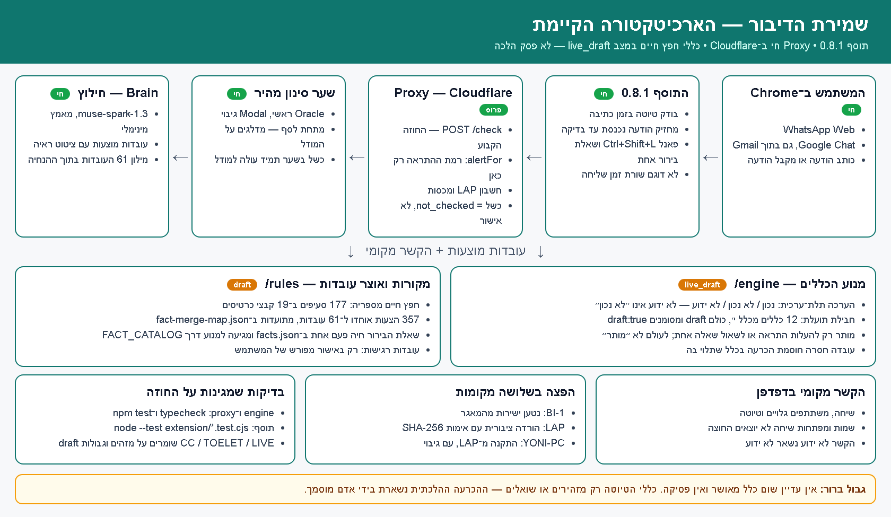
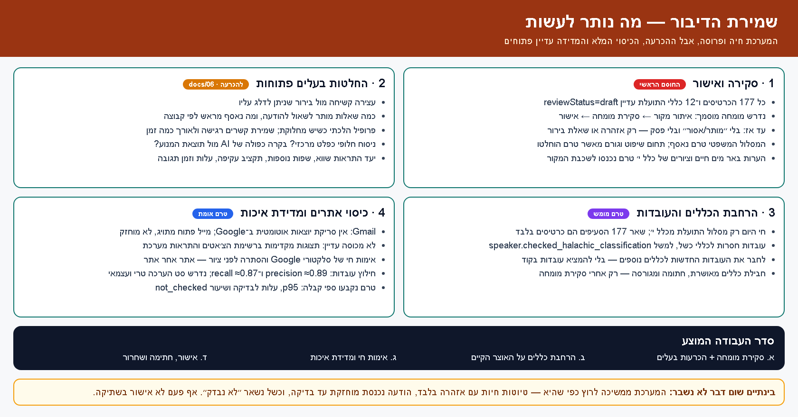

# 21 — ארכיטקטורה אינפוגרפית: הקיים והנותר

מסמך תמונה אחד לשני השאלות שחוזרות בכל דיון: **מה כבר עובד**, ו**מה עוד לא סגור**.
התמונות הן צילום מצב היסטורי של `0.8.1`; הטקסט להלן עודכן להרחבת `0.8.2`. התמונות אינן ראיה למצב הפריסה החי. מיפוי הכללים העדכני נמצא במסמך 22.

## הקיים

Chrome ‏← תוסף `0.8.2` ‏← Proxy ב־Cloudflare ‏(`POST /check`, שם ורק שם מוגדרת רמת ההתראה) ‏← שער סינון (Oracle ראשי, Modal גיבוי; כשל תמיד עולה למודל) ‏← Brain מחלץ עובדות מוצעות עם ראיות ‏← מנוע `engine/` מעריך `CC_ALL_DRAFT_PACK`: אחת עשרה חבילות, 234 תזכורות מותנות במצב `live_draft` (היקף וחסמים ב־docs/25).

הגבולות שנאכפים בקוד ובבדיקות:

- הערכה תלת־ערכית: עובדה לא ידועה אינה ״לא נכון״, וחוסמת הכרעה בכלל שתלוי בה.
- כללי הטיוטה מותר להם רק להעלות התראה או לשאול שאלה אחת. לעולם לא ״מותר״, ולא להוריד התראה.
- כשל בכל שלב הוא `not_checked` — הודעה נכנסת נשארת מוחזקת, וזה אף פעם לא אישור בשתיקה.
- אוצר העובדות: 161 עובדות קנוניות, לאחר איחוד ההצעות והשלמת הבחנות מקור (`rules/chafetz-chaim/facts.json`, ההכרעות ב־`fact-merge-map.json`); חמש עובדות השיעור משלימות קטלוג של 166. נוסח השאלה והמטא־נתונים מיוצרים ממקור אחד; ציוני confidence מחוץ לתחום וטיפוסים שגויים נדחים.
- המקור: 177 סעיפי חפץ חיים מספריה ב־19 קבצי כרטיסים, כולם `draft`.
- הפצה: BI-1 (מהמאגר), LAP (עם אימות SHA-256), YONI-PC (מה־ZIP של LAP). פרטים: `docs/19-fact-vocabulary.md`, `docs/18-toelet-rules.md`, `docs/15-incoming-hold.md`.

## הנותר

בקצרה, לפי סדר חסימה:

1. **סקירת מומחה והכרעות בעלים** — כל הכרטיסים והכללים עדיין `draft`; בלי אישור מוסמך אין פסק ואין ״מותר/אסור״. השאלות הפתוחות מרוכזות ב־`docs/06-decisions.md`, והמסלול המשפטי טרם נאסף.
2. **ענפי כללים ומגבלותיהם** — תשע חבילות מחוברות לפרוקסי בקוד; סטטוס פריסת ההרחבה ב־docs/24. 177 סעיפים ממופים בנפרד למימושים ולמגבלותיהם במסמך 22; קישור לתזכורת אינו מימוש כל הסעיף. חריגי פרסום י׳:ח–ט מיוצגים בעובדות ממוקדות ובבירור; הכרעת הפחד שבח׳ דורשת מומחה. הכרעות בית דין וקניין ופרטים שאין להם עובדות מדויקות מפורטים כחסמים במטריצה. אישור משתמש על עצם בדיקת סיווג המעשה אינו סיווג הלכתי אוטומטי.
3. **כיסוי ומדידה** — אין סריקת יוצאות אוטומטית ב־Google, תצוגות מקדימות והתראות אינן מכוסות, וסלקטורי Google וההסתרה לפני ציור טרם אומתו אתר־אתר. חילוץ העובדות נמדד לאחרונה ב־precision ≈0.89 ו־recall ≈0.87 (`docs/20-fact-extraction-eval.md`) ונדרש סט הערכה טרי ועצמאי לפני כוונון נוסף.

עד שייסגרו אלה, המערכת ממשיכה לרוץ בדיוק במגבלות שלמעלה: אזהרה או שאלה, לא הכרעה.
