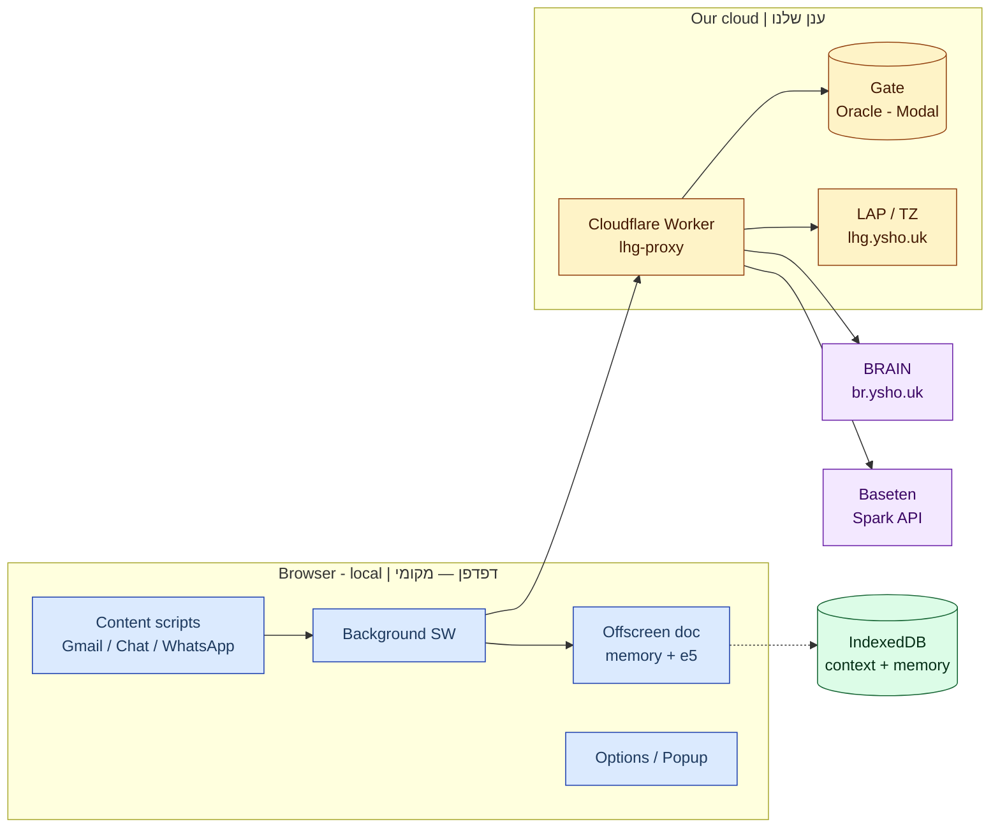

# LHG Architecture — Lashon Hara Guard | ארכיטקטורת LHG

> Bilingual: Hebrew in [he/](he/), English in [en/](en/) — same file names, sections, tables, source links and diagrams.
> דו־לשוני: עברית ב־[he/](he/), אנגלית ב־[en/](en/) — אותם שמות קבצים, סעיפים, טבלאות, קישורי מקור ותרשימים.
> Base: `origin/main` @ `a33cfd6` (2026-10-29, extension 0.14.0; Hebrew docs first written at `90369fc`, updated for `docs/TECH-DEBT.md`).

Chrome MV3 extension that warns about speech that could be read as disparaging (Chafetz Chaim draft rules), with a Cloudflare Worker proxy, a gate classifier (Oracle + Modal), cloud extraction (Baseten Spark) and local modes (Ollama GGUF, DictaLM).
תוסף Chrome MV3 שמתריע על דיבור שעלול להתפרש כגנאי (כללי טיוטה מחפץ חיים), עם Cloudflare Worker proxy, מסווג gate (Oracle + Modal), חילוץ ענן (Baseten Spark) ומצבים מקומיים (Ollama GGUF, DictaLM).

## Reading order | סדר קריאה

| # | Hebrew | English | Content | תוכן |
|---|---|---|---|---|
| 1 | [he/01-system-context.md](he/01-system-context.md) | [en/01-system-context.md](en/01-system-context.md) | Actors, external systems, trust boundaries (C4 L1) | שחקנים, מערכות חיצוניות, גבולות אמון |
| 2 | [he/02-containers.md](he/02-containers.md) | [en/02-containers.md](en/02-containers.md) | Extension parts, proxy, gate, Brain, Baseten, LAP (C4 L2) | רכיבי התוסף, proxy, gate, Brain, Baseten, LAP |
| 3 | [he/03-check-flow.md](he/03-check-flow.md) | [en/03-check-flow.md](en/03-check-flow.md) | Check sequences: outgoing, incoming, context loop, cache | רצפי בדיקה: יוצאת, נכנסת, לולאת הקשר, מטמון |
| 4 | [he/04-check-modes-and-presets.md](he/04-check-modes-and-presets.md) | [en/04-check-modes-and-presets.md](en/04-check-modes-and-presets.md) | Modes, 2x3 presets, cloud models, migration | מצבים, presets 2×3, מודלי ענן, מיגרציה |
| 5 | [he/05-data-and-privacy.md](he/05-data-and-privacy.md) | [en/05-data-and-privacy.md](en/05-data-and-privacy.md) | Data flows, storage, retention, ContextPacket limits | זרימת נתונים, אחסון, שמירה, גבולות ContextPacket |
| 6 | [he/06-rules-engine.md](he/06-rules-engine.md) | [en/06-rules-engine.md](en/06-rules-engine.md) | Fact catalog, live_draft, three-valued logic | קטלוג עובדות, live_draft, לוגיקה תלת־ערכית |
| 7 | [he/07-models-and-ml.md](he/07-models-and-ml.md) | [en/07-models-and-ml.md](en/07-models-and-ml.md) | Gate, extractor, router — training and evaluation | gate, extractor, router — אימון והערכה |
| 8 | [he/08-security-billing-ops.md](he/08-security-billing-ops.md) | [en/08-security-billing-ops.md](en/08-security-billing-ops.md) | Auth, billing, rate limits, deploy | אימות, חיוב, rate limits, פריסה |
| 9 | [he/09-decisions-and-debt.md](he/09-decisions-and-debt.md) | [en/09-decisions-and-debt.md](en/09-decisions-and-debt.md) | Decisions, technical debt, open questions | החלטות, חוב טכני, שאלות פתוחות |

## One-page overview | דיאגרמת סקירה

Source: [extension/manifest.json](../../extension/manifest.json), [proxy/src/handler.ts](../../proxy/src/handler.ts).

## Canonical sources | מקורות קנוניים

- [AGENTS.md](../../AGENTS.md) — the most current summary (read first). | התקציר העדכני ביותר (קראו תחילה).
- [docs/18](../18-toelet-rules.md) — canonical `/check` contract (changed without backward compatibility, owner decision 2026-10-29). | חוזה `/check` הקנוני.
- [docs/48](../48-cloud-context-loop.md) — needs loop (cloud + local). | לולאת needs.
- [docs/TECH-DEBT.md](../TECH-DEBT.md) — technical-debt register. | מרשם החוב הטכני.
- [PRIVACY.md](../../PRIVACY.md) — controlled privacy policy (2026-10-29). | מדיניות פרטיות מבוקרת.
- [docs/06-decisions.md](../06-decisions.md) — decisions U-01..U-07. | החלטות U-01..U-07.

## Diagram conventions | מוסכמות תרשימים

Same visual style in every document (`classDef`): blue = browser-local, yellow = our cloud, purple = third party, green = data store. "Unverified / לא אומת" marks a claim with no source found in the reviewed code or docs.
אותו סגנון חזותי בכל המסמכים (`classDef`): כחול = דפדפן־מקומי, צהוב = ענן שלנו, סגול = צד שלישי, ירוק = מאגר נתונים. הצהרת ״לא אומת״ מסמנת טענה שלא נמצא לה מקור בקוד או במסמך שנסקר.
