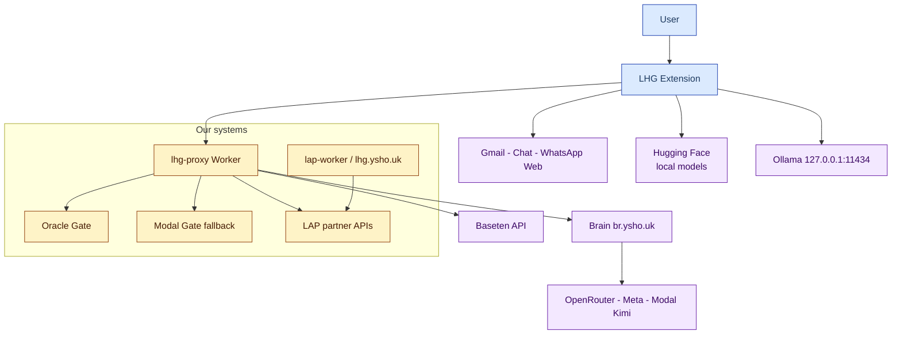

# 01 — System context (C4 Level 1)

## Purpose

LHG (Lashon Hara Guard) warns before sending and next to incoming messages when text could be read as disparaging, per a Chafetz Chaim draft pack (`CC_ALL_DRAFT_PACK`, mode `live_draft`). There is no ruling: the top-level output is only `alert in {warn, unsure, none, not_checked}`, whose single home is [`alertFor` in handler.ts](../../../proxy/src/handler.ts#L131). Source: [docs/18](../../18-toelet-rules.md).

## Actors

| Actor | Description | Source |
|---|---|---|
| Public end user | Installs from `https://lhg.ysho.uk`, `lap_...` token, LAP billing | [docs/50](../../50-public-distribution.md) |
| Private user (owner) | Legacy access key, full model picker | [check-mode.js](../../../extension/check-mode.js#L33) |
| LAP admin | Hold recovery, balance management (manual) | [accountAccess.ts](../../../proxy/src/accountAccess.ts) |
| Rabbi / halakha expert | Future draft-pack review; group D = referral only | [docs/42](../../42-rabbi-referral-artifact.md) |

Requirements U-03/U-04: incoming scanning is a core requirement; target platforms are WhatsApp Web, Gmail, Google Chat. Source: [docs/06-decisions.md](../../06-decisions.md).

## External systems

| System | Role | Source |
|---|---|---|
| Cloudflare Workers | `lhg-proxy` — the only entry point from the extension | [proxy/src/handler.ts](../../../proxy/src/handler.ts#L23) |
| Oracle (`82.70.209.225`) | Primary gate, container `lhg-gate`, `127.0.0.1:8090`, tunnel `/lhg-gate/*` | [AGENTS.md](../../../AGENTS.md), [docs/16](../../16-gate-oracle.md) |
| Modal | Gate fallback (`serve_modal.py`, v2 fp32); extractor/router training | [docs/12](../../12-gate-classifier.md) |
| Brain (`br.ysho.uk/dash`) | Completions path for cloud models (meta_api/openrouter/modal), `muse-spark-1.3`, `reasoning_effort=minimal` | [AGENTS.md](../../../AGENTS.md), [docs/10](../../10-brain-send-backend.md) |
| Baseten | `meta-models/muse-spark-open-1026` — default + direct public path | [baseten.ts](../../../proxy/src/baseten.ts) |
| LAP / TZ (`lhg.ysho.uk`) | Tokens, balances, begin/finish; download site + token management | [accountAccess.ts](../../../proxy/src/accountAccess.ts) |
| Hugging Face | Public GGUFs: `yonicc/lhg-extractor-*-gguf`; e5/router models (~135MB) | [AGENTS.md](../../../AGENTS.md) |
| Ollama (local) | Local extractor inference, `127.0.0.1:11434` | [docs/45](../../45-ollama-local.md) |

## Trust boundaries

1. **Browser <-> Worker**: only `x-lhg-key` (`lap_...` or legacy key). The extension never sees the Brain/Baseten tokens — they are Worker secrets. Source: [background.js](../../../extension/background.js#L1).
2. **Worker <-> LAP**: `LHG_ACCOUNT_KEY` (secret, names only — no values). No message text goes to the account service. Source: [accountAccess.ts](../../../proxy/src/accountAccess.ts#L5).
3. **Worker <-> model providers**: every server call uses `redirect:'manual'` and rejects 3xx — credentials never follow a redirect. Source: [AGENTS.md](../../../AGENTS.md).
4. **Untrusted content**: context/memory snippets are `candidate/dom_observed` — never `confirmedFacts`/evidence. Source: [docs/48](../../48-cloud-context-loop.md).
5. **Model <-> tools**: the model only picks bounded read requests (`get_recent`/`search_history`) and catalog fact ids; scope/account/conversation are set by code. Source: [engine/src/needs.ts](../../../engine/src/needs.ts).

> Open boundary: `PRIVACY.md` states explicitly — there is no zero-retention guarantee from upstream providers (logging, training use). Actual Baseten/Brain retention is unverified. Source: [PRIVACY.md](../../../PRIVACY.md#L39).
