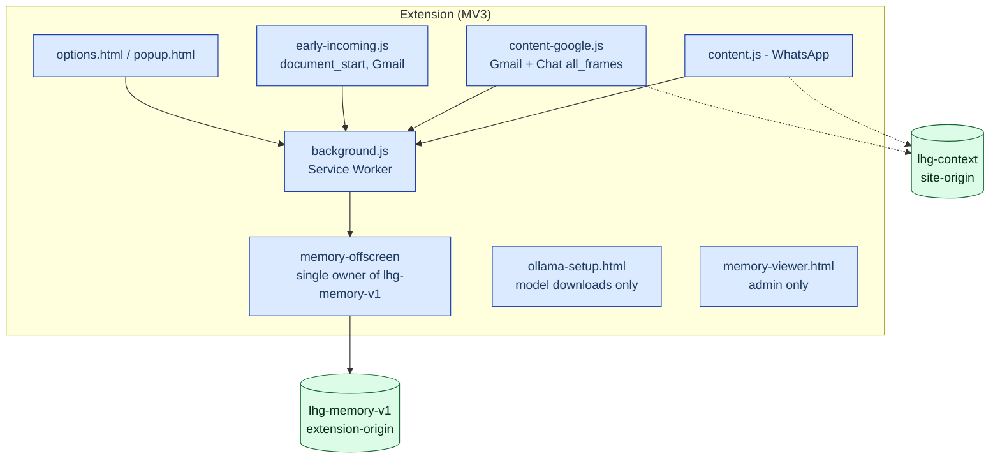

# 02 — Containers (C4 Level 2)

## Chrome MV3 extension (version 0.14.0)

Source: [extension/manifest.json](../../../extension/manifest.json) — `minimum_chrome_version: 116`, permissions: `storage, tabs, offscreen`.

| Component | Responsibility | Source |
|---|---|---|
| `content.js` (WhatsApp) | Incoming/outgoing scan, panel, compose-watch | [manifest.json](../../../extension/manifest.json#L29) |
| `content-google.js` | Gmail + Google Chat; `all_frames:true` because Chat runs in a `chat.google.com` iframe | [manifest.json](../../../extension/manifest.json#L36), [AGENTS.md](../../../AGENTS.md) |
| `early-incoming.js` | CSS guard at `document_start` for Gmail — hides incoming before check | [docs/15](../../15-incoming-hold.md) |
| `background.js` | **The only network talker**; local/cloud routing, needs loop, cache | [background.js](../../../extension/background.js#L1) |
| `memory-offscreen.mjs` | Single owner of central memory; e5 embeddings (WASM); delete/expire | [docs/36](../../36-extension-local-memory.md) |
| `ollama-setup.html` | **The only requester allowed** to call `/api/pull` (exact sender URL); closing = cancel setup | [docs/45](../../45-ollama-local.md) |
| `memory-viewer.html` | stats/list/search/delete — only from `options.html`/`memory-viewer.html` (exact URL) | [memory-background.js](../../../extension/memory-background.js) |

WhatsApp selectors live only in [selectors.js](../../../extension/selectors.js); message direction only in `S.isOutgoing` there. Source: [AGENTS.md](../../../AGENTS.md).

## Worker proxy (`lhg-proxy`)

| Module | Role |
|---|---|
| [handler.ts](../../../proxy/src/handler.ts) | `POST /check`, `POST /warm`; `alertFor` — single home of the alert level |
| [accountAccess.ts](../../../proxy/src/accountAccess.ts) | validate → LIMITER → begin (reservation) → check → finish (settlement) |
| [cloudModels.ts](../../../proxy/src/cloudModels.ts) | Model allow-list; default = Baseten Spark |
| [baseten.ts](../../../proxy/src/baseten.ts) | `BasetenExtractorProvider` — direct public path, server-fixed model |
| [throttle.ts](../../../proxy/src/throttle.ts) | Fail-closed: limiter error → 503, refusal → 429 |
| [limits.ts](../../../proxy/src/limits.ts) | `MAX_TEXT_CHARS=2000`; further limits from engine |

Flow: `EDGE_LIMITER (120/min/IP)` → `personalCheck` (LAP) → `LIMITER (30/min/account)` → gate → extraction → rules. Source: [AGENTS.md](../../../AGENTS.md), [docs/27](../../27-security-review.md).

## Gate (Oracle primary / Modal fallback)

- Single routing rule: [`classifier/gate_route.py`](../../../classifier/gate_route.py) — Hebrew only → v2; any Latin letter → `max(v2, v4-xlmr-ml)`. Imported by both `oracle/server.py` and `serve_modal.py`.
- `p < LHG_GATE_THRESHOLD (0.2)` skips the model; gate failure/timeout **always** escalates to the model — the gate only saves, never hides. Source: [AGENTS.md](../../../AGENTS.md).
- Oracle: container `lhg-gate` (cores 2–3, 3GiB), `127.0.0.1:8090`. Modal: fallback, Volume `lhg-models`.

## Additional services

| Service | Role |
|---|---|
| Brain (`br.ysho.uk/dash`) | Stateless completions for the private path (`meta_api`/`openrouter`/`modal` only; `claude`/`codex` excluded — they run CLIs with tools) — [cloudModels.ts](../../../proxy/src/cloudModels.ts#L9) |
| LAP/TZ (`lhg.ysho.uk`) | `lap_...` tokens, grants, balances, daily quota; public extension download — [docs/13](../../13-lap-access.md) |
| `lap-worker` | Public site: personal token management + `/downloads/` for the extension — [AGENTS.md](../../../AGENTS.md) |
| Ollama (local) | `127.0.0.1:11434`, GGUF Q4_K_M via `ollama-client.js` — [docs/45](../../45-ollama-local.md) |

> **Main update (`a33cfd6`):** the debt register [docs/TECH-DEBT.md](../../TECH-DEBT.md) is now on `origin/main` — see [09](09-decisions-and-debt.md). The local decider (a separate meaning classifier) is still **in progress** per that document; it does not complete the extractor-contract work and never turns missing facts into false.
