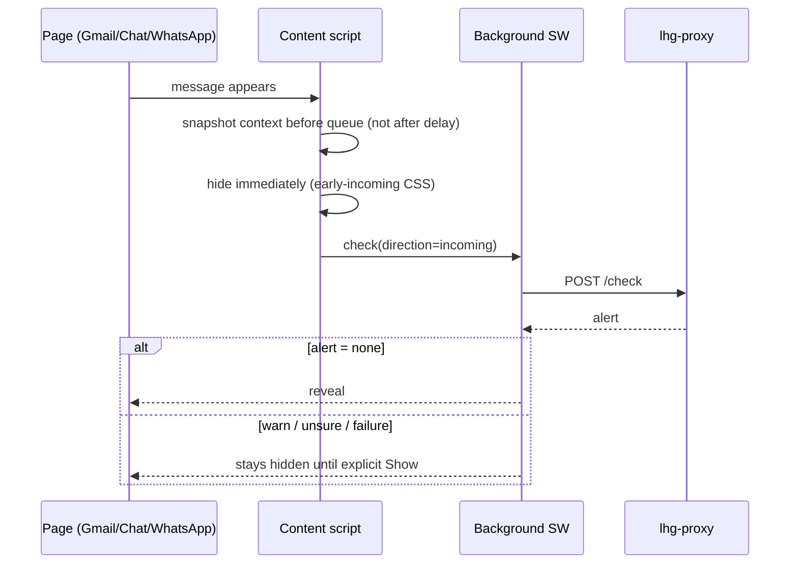

# 03 — Check flows

## `/check` contract (canonical: docs/18)

Request: `text, platform, direction, context?, confirmedFacts?, userNote?(<=500), lang?, model?, round?(1-3)`. Response: `alert, status, analysis?, rules?, needs?, gate?, model?`. The loop contract is in [`engine/src/needs.ts`](../../../engine/src/needs.ts): up to 2 requests (`get_recent {n<=20}` / `search_history {query<=300, top_k<=5}`) and up to 5 catalog questions. Every round = a new, separately billed `/check`. Source: [docs/48](../../48-cloud-context-loop.md), [docs/18](../../18-toelet-rules.md).

## Outgoing compose check

```mermaid
sequenceDiagram
  actor U as User
  participant CS as Content script
  participant BG as Background SW
  participant PX as lhg-proxy
  participant GT as Gate
  participant EX as Extractor
  U->>CS: Send / Enter press
  CS->>BG: check(text, context, round=1)
  BG->>PX: POST /check (x-lhg-key)
  PX->>PX: EDGE 120/min, LAP validate, LIMITER 30/min, begin
  PX->>GT: score(text)
  alt p < 0.2 and no open needs
    GT-->>PX: skipped_local_gate
  else
    PX->>EX: extraction (text + context + userNote)
    EX-->>PX: facts + meaning + needs
    PX->>PX: runLiveRules, alertFor
  end
  PX->>PX: finish (settlement)
  PX-->>BG: alert + rules/needs
  alt open needs and memory on (max 3 rounds)
    BG->>BG: scoped fetch, mask, sanitizeContextPacket
    BG->>PX: POST /check (round+1, new billing)
  end
  BG-->>CS: result / questions
  CS-->>U: Send anyway available at once; second send = bypass
```

Critical rules (source: [AGENTS.md](../../../AGENTS.md), [compose-watch.js](../../../extension/compose-watch.js)):

- **Outgoing never captures send** (owner decision 2026-10-29): "Send anyway" is shown immediately during the check; a second native send bypasses explicitly. The bypass cancels liveness before replay — a late response never re-sends and never opens context rounds.
- Typing alone never triggers a check; only a send attempt or a manual check (Ctrl+Shift+L / panel).
- Gmail: click and Ctrl+Enter; Chat/WhatsApp: click/Enter (shared `compose-watch.js`). Indeterminate progress.
- Questions are sent only on "Send answers and re-check" — selecting alone is neither a request nor a charge ([docs/41](../../41-five-question-contract.md)).

## Incoming message check



Policy (owner decision 2026-10-27, [docs/15](../../15-incoming-hold.md)): incoming stays hidden until checked; failure or warning means hidden until an explicit click. Incoming never shows a popup — only an inline tag; the manual panel is Ctrl+Shift+L. Source: [AGENTS.md](../../../AGENTS.md).

Implementation notes: Gmail history is rebuilt per check and snapshotted before the queue (switching conversations never changes a pending request); own echoes keep direction by DOM node+text for 20 seconds (`LHG_COMPOSE.recentlySent`). Source: [extension/GMAIL-CHECKS.md](../../../extension/GMAIL-CHECKS.md).

## Context loop (cloud + local, max 3 rounds)

Runs in [`extension/context-loop.js`](../../../extension/context-loop.js) (background, shared path):

1. Round 1 as usual. If `needs.requests/questions` is empty — done.
2. Fetch via the memory bridge under the captured scope (account+conversation): `get_recent` / `search_history`, 5s fetch timeout.
3. Masking (names/email/phone) in the original content frame (`builder.mergeMemory`), then `sanitizeContextPacket` in background.
4. Next round with the snippets (shared 5x300 budget) — as untrusted data, never `confirmedFacts`.
5. Stop: 3 checks, repeat/no new snippets, memory off, missing scope, error. Failure keeps the last result/questions — never an approval. Pending/stopped loops never enter the cache.

Source: [docs/48](../../48-cloud-context-loop.md).

## Local modes + fallback + union

- `local-fast` (7B Q4) / `local-hebrew` (DictaLM Q4) / `local-union` (both): narrow extractor `alias:[bool,quote]` only — no meaning assessment; the result stays unresolved. Source: [docs/45](../../45-ollama-local.md), [docs/49](../../49-extractor-v2-ollama.md).
- Engine unavailable means `not_checked (local_unavailable)`; cloud only if `lhgCloudFallback=true`. Never a silent `none`. Source: [check-mode.js](../../../extension/check-mode.js).
- In local mode, `needs` derives from router heads (`mem_recent`→`get_recent`, `mem_search`→`search_history` with the message as query, `ask_user`→catalog questions) + unanswered catalog facts from the engine. Router off by default; missing/failed means deterministic questions only.

## Result cache

Local extension storage, key = SHA-256 of (account, message/conversation id, content, context, check config incl. mode/model). Reuse up to 14 days, up to 500 entries. Errors are never stored as success; "Check again" bypasses the cache. Source: [background.js](../../../extension/background.js), [PRIVACY.md](../../../PRIVACY.md#L14).
