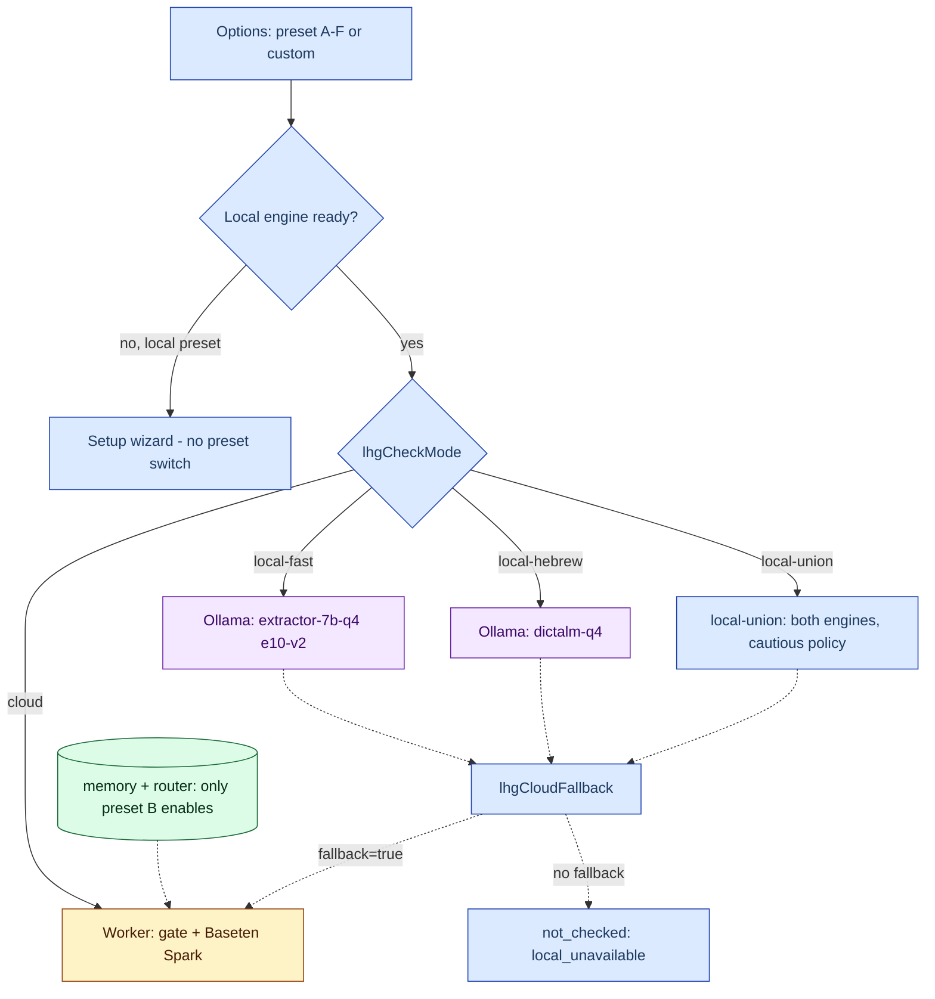

# 04 — Check modes and presets

## Single homes

- [`extension/check-mode.js`](../../../extension/check-mode.js) — the single home of `lhgCheckMode`, `lhgCloudFallback`, `lhgCloudModel` and the local-engine interface (`registerLocalEngine`).
- [`extension/check-presets.js`](../../../extension/check-presets.js) — the single home of the preset grid; `options.js` only renders, `preset-grid.css` only styles.

**Diagram — from preset to engine:**

## Modes (`lhgCheckMode`)

| Mode | Engine | On failure |
|---|---|---|
| `cloud` (default) | Worker → gate → cloud model | `not_checked` on network/HTTP error |
| `local-fast` | `extractor-7b-q4` (Qwen 7B Q4_K_M, e10-v2) | `local_unavailable` unless fallback |
| `local-hebrew` | `dictalm-q4` (DictaLM Q4, contract v1) | same |
| `local-union` | both engines, cautious policy (alert/needs) | same |

A local mode that cannot run is `not_checked (error:'local_unavailable')` — never `none` and never a silent switch to cloud. Local modes extract facts only (no meaning assessment) — the result stays unresolved. Source: [check-mode.js](../../../extension/check-mode.js), [docs/45](../../45-ollama-local.md).

## Preset grid 2x3

Columns: `cloud | combined | local`; rows: `fast | accurate`. Each preset is only a named combination of the existing switches. Levels 1–5 (high = better; cost 5 = free).

| ID | Column/row | mode | fallback | memory+router | speed/accuracy/privacy/cost |
|---|---|---|---|---|---|
| A | cloud/fast | cloud | false | false | 5/3/2/2 |
| B | cloud/accurate | cloud | false | true | 4/5/1/2 |
| C | combined/fast | local-fast | true | (untouched) | 3/2/4/4 |
| D | combined/accurate | local-union | true | (untouched) | 2/3/4/4 |
| E | local/fast | local-fast | false | (untouched) | 3/2/5/5 |
| F | local/accurate | local-union | false | (untouched) | 2/3/5/5 |

Source: [check-presets.js](../../../extension/check-presets.js#L21), tests: [check-presets.test.cjs](../../../extension/check-presets.test.cjs).

Important behaviors:
- A preset **never** changes the cloud model (`patchFor` does not touch it).
- A local preset whose engines are not ready opens the setup wizard instead of switching — switching would leave every message `not_checked`. Source: `needsInstall` in [check-presets.js](../../../extension/check-presets.js).
- `presetOf` returns `null` ("custom") when there is no full match; in local presets the memory field stays the user's Advanced choice.

## Cloud models

Double allow-list — client ([check-mode.js](../../../extension/check-mode.js) `CLOUD_MODELS`) and server ([cloudModels.ts](../../../proxy/src/cloudModels.ts) — the real gate). `proxy/test/cloudModels.test.ts` fails when the lists differ.

| | Private (legacy key) | Public (`lap_...`) |
|---|---|---|
| List | 12 models (Baseten, Meta, OpenRouter, Modal Kimi) | **only** `muse-spark-open-1026` (direct Baseten) |
| Default | Baseten Spark — sends **without** a `model` field | server-fixed (`LHG_PUBLIC_CHECK` derived only from accountAccess) |
| `model` field in response | only if the request sent one | list ignored |

Source: [cloudModels.ts](../../../proxy/src/cloudModels.ts), [docs/50](../../50-public-distribution.md).

Current default (owner 2026-10-29): Baseten `muse-spark-open-1026` in both builds. `pickCloudModel` maps absent/unknown/default to it — old extensions migrate too. `muse-spark-1.3` remains an explicit `meta_api` entry. Brain `agent_kind=baseten` answered in ~1.2s (2026-10-29). Source: [cloudModels.ts](../../../proxy/src/cloudModels.ts#L53), [AGENTS.md](../../../AGENTS.md).

Only stateless Brain branches are allowed (`meta_api`, `openrouter`, `modal`). Candidates that failed the smoke test under the Worker's 20s timeout (deepseek, kimi, glm, gpt-oss) are not listed — see the header of [cloudModels.ts](../../../proxy/src/cloudModels.ts).

## Default migration

`migrateDefault` in [check-mode.js](../../../extension/check-mode.js#L73): one-time `muse-spark-1.3 → muse-spark-open-1026`, marker `lhgCloudDefaultV=2`. Needed because saving any mode also saved the old default; re-selecting 1.3 after migration is kept. The public build renders only Baseten (prepend of `LHG_PUBLIC_BUILD=true` to check-mode.js; never installed over the owner's source tree). Source: [docs/50](../../50-public-distribution.md).
