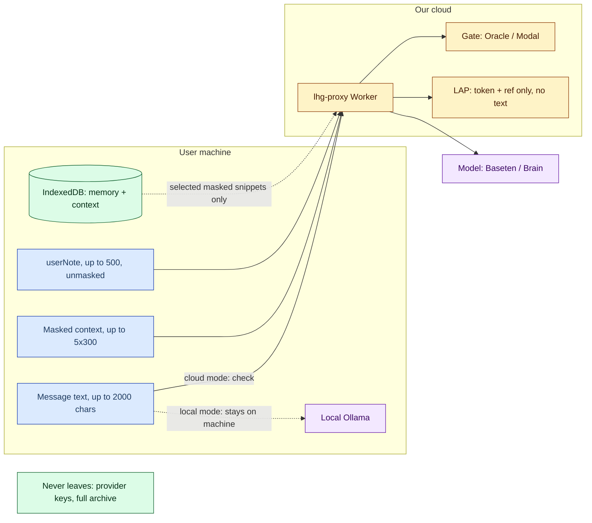

# 05 — Data and privacy

> Controlled source: [PRIVACY.md](../../../PRIVACY.md) (updated 2026-10-29). **Never claim everything stays local**: `/check` sends message text, context and `userNote` for remote processing; account/billing records are remote.

**Diagram — data flow and trust boundaries by mode:**

## What leaves the machine, and where

| Data | Destination | Condition | Source |
|---|---|---|---|
| Message text (up to 2000 chars) | Worker → gate; and if needed, model | every cloud `/check` | [limits.ts](../../../proxy/src/limits.ts), [handler.ts](../../../proxy/src/handler.ts) |
| Context snippets (up to 5x300) | Extraction model | if `context` is sent | [contextPacket.ts](../../../engine/src/contextPacket.ts) |
| `userNote` (up to 500, truncated) | Model — as quoted data only | optional; not a fact/evidence, never lowers concern | [handler.ts](../../../proxy/src/handler.ts#L189) |
| `confirmedFacts` answers (catalog ids, up to 20) | Worker → rules engine | after questions | [docs/18](../../18-toelet-rules.md) |
| Token + transaction ref (no text!) | LAP partner APIs | `lap_` path only | [accountAccess.ts](../../../proxy/src/accountAccess.ts) |
| Selected memory snippets (up to 5x300, masked) | the chosen check service (cloud too) | needs loop, up to 3 rounds | [docs/48](../../48-cloud-context-loop.md) |
| Model downloads (e5 ~135MB, router ~191MiB, GGUF) | Hugging Face / Ollama | explicit in options/setup only | [PRIVACY.md](../../../PRIVACY.md) |

The gate receives the message text; extraction may also receive context snippets and `userNote`. A `/warm` request contains auth only, no conversation content. A custom service URL (`proxyUrl`) changes the recipient. Source: [PRIVACY.md](../../../PRIVACY.md#L29).

## What stays local only

- Conversation names/display, DOM keys — stay in the browser; `participantCount` is omitted unless independently known. Source: [AGENTS.md](../../../AGENTS.md).
- All central memory (`lhg-memory-v1`) — text + vectors; search is local. Source: [docs/36](../../36-extension-local-memory.md).
- Result cache (hashed keys, no raw text in the key). Source: [background.js](../../../extension/background.js).

## Local storage

| Store | Keys/content | Retention | Source |
|---|---|---|---|
| `chrome.storage.local` | settings, token, service URL, language (`lhgLang`), platform switches (`lhgEnabled`, `lhgPlatforms`), panel geometry (`lhgPanelGeom`), mode/model/presets | no sync | [settings.js](../../../extension/settings.js), [i18n.js](../../../extension/i18n.js) |
| Result cache (extension storage) | SHA-256 of account/message/content/context/config; may contain explanation/quote | 14 days, up to 500 entries; errors never stored | [PRIVACY.md](../../../PRIVACY.md#L14) |
| IDB `lhg-context` (site-origin!) | conversation ids, participant mapping, snippets (<=1000 chars, <=30/conversation), facts, relations | messages >14 days cleaned at startup; conversations/participants/facts/relations have **no** such expiry; not an encrypted vault | [PRIVACY.md](../../../PRIVACY.md#L15) |
| IDB `lhg-memory-v1` (extension-origin, off by default) | text + e5 vectors together (same delete/expire unit); includes unsent drafts | 14 days from first view; up to 20,000 sources / 5M chars; source <=100K chars, chunks <=1000 | [PRIVACY.md](../../../PRIVACY.md#L62), [docs/35](../../35-local-memory-ingestion-and-browser-test.md) |

Uninstalling the extension alone can leave site IDB behind; full deletion requires clearing storage + site data. Source: [PRIVACY.md](../../../PRIVACY.md#L45).

## ContextPacket — hard limits

- Single canonical source: [`engine/src/contextPacket.ts`](../../../engine/src/contextPacket.ts) + `sanitizeContextPacket`; the proxy sanitizes before extraction.
- Budget: up to **5 snippets x 300 chars**; a `context` field over `MAX_CONTEXT_JSON_CHARS=6000` is **dropped entirely** (never partially truncated — partial would look complete to the model). Non-plain-object context means the single-message path, never a 400. Source: [handler.ts](../../../proxy/src/handler.ts#L98).
- Context building masks known display names, emails and phone-like numbers — **this is not an anonymity guarantee**. The main message and `userNote` are sent **without** masking. Source: [PRIVACY.md](../../../PRIVACY.md#L31).
- Provenance is kept for every fact: `user_confirmed` only from the explicit builder; `candidate/unknown` never become false.

## What never leaves

- Message text to the account service (token + refs only). Brain/Baseten keys to the browser. Raw names as part of cache keys.
- The full memory archive — only up to 5 selected, masked snippets per round.

## Alignment with PRIVACY.md — known gaps

- There is no persistent message archive in the reviewed proxy/classifier code, and the model adapter is stateless — **but that does not prove zero retention** across the provider chain. Baseten/Brain/Oracle retention periods are unverified.
- The viewer shows masked text by default, vectors are never displayed, "show all" is not persisted. Source: [PRIVACY.md](../../../PRIVACY.md#L17).
