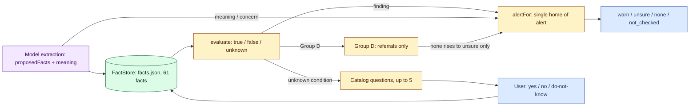

# 06 — Rules engine

## Top principle

The deterministic engine is the only decider; a model/router never rules on halakha, never returns "permitted", and never lowers concern. All pack texts are banned from the standalone words for permitted/forbidden (test TOELET-02). Source: [docs/18](../../18-toelet-rules.md), [docs/41](../../41-five-question-contract.md).

**Diagram — from fact to alert:**



## Fact catalog — single home

- Texts and ids: [`rules/chafetz-chaim/facts.json`](../../../rules/chafetz-chaim/facts.json) → `FACT_CATALOG` (61 facts). TOELET-04 fails if the catalog deviates from facts.json.
- Single conversion to a fact store: [`engine/src/liveFacts.ts`](../../../engine/src/liveFacts.ts) `factStoreFromExtraction` (`proposedFacts + meaning + user answers`).
- Acceptance by confidence: [`extractor/factPolicy.ts`](../../../engine/src/extractor/factPolicy.ts) — rejects non-finite/out-of-range scores; **never clamps** a score to 0..1 (clamping 2→1 once promoted corrupt meaning to a known fact). Source: [AGENTS.md](../../../AGENTS.md).

## Chafetz Chaim packs — `live_draft`

Owner decision 2026-10-27: `CC_ALL_DRAFT_PACK` (11 packs, 234 reminders) runs in the live flow as if approved — `evaluate(..., ruleMode:'live_draft')` yields findings with `draft:true`; switch `LHG_CC_RULES=live|off`. Expert review is deferred to an improvement round. Source: [AGENTS.md](../../../AGENTS.md), [docs/18](../../18-toelet-rules.md).

Hard blockers (never broken):
- A rule only raises to `warn` (only inside `alertFor`) or asks (up to 5) — never lowers to `none`.
- A missing fact = **unknown**, never false; "don't know" = `null` = unknown.
- Declared benefit alone permits **nothing** (LIVE-05).
- Engine failure means `rules.notChecked=true`, alert unchanged.
- Exceptions share the three-valued semantics: an unknown/contested exception blocks a finding and may require clarification.

## Three-valued logic

`evaluate` in [engine/src/evaluate.ts](../../../engine/src/evaluate.ts) over `FactStore` in [engine/src/factStore.ts](../../../engine/src/factStore.ts): every condition/exception is in {true, false, unknown}. An unknown condition yields a clarification question about it (TOELET-06/08); a failed condition yields a draft explaining which condition is missing (TOELET-07/09). Rules in `approved_only` (the default) produce only internal `draftObservations`, never user findings (TOELET-05/07/09).

## Questions — contract (docs/18 canonical, docs/41)

- Up to **5 catalog questions** per check (`MAX_QUESTIONS=5` in [proxy/src/rules.ts](../../../proxy/src/rules.ts)); `question?` remains only a compatibility mirror of `questions[0]` for old clients.
- Texts only from `FACT_CATALOG`; yes/no/don't-know format (`true/false/null`). An answered question (including "don't know") is never asked again.
- When there is at least 1 catalog question, free-form `analysis.questionsHe` questions are suspended (empty array); otherwise at most one analysis question is kept. Source: [handler.ts](../../../proxy/src/handler.ts).
- Question-cache note in `docs/18`: a user question is not a confirmed fact for reuse without provenance/scope/validity. Source: [AGENTS.md](../../../AGENTS.md).

## Group D — referral only

All 73 group-D items produce only `rules.referrals?: RabbiReferral[]` — in partial coverage and in approved fixtures alike. No finding, draft observation or ruling comes from them. A pending referral leaves `needs_clarification`; in `alertFor` it raises `none→unsure` only. Referrals are not in the 5-question quota. Runtime data is generated by `scripts/generate-referral-data.mts`; the workerd test in `proxy/test/referralWorker.test.ts` must stay green. Source: [docs/42](../../42-rabbi-referral-artifact.md), [AGENTS.md](../../../AGENTS.md).

## `alertFor` — single home of the alert level

```text
if rules.findings.length > 0           -> warn
else extractionAlert(outcome)          -> warn/unsure/none/not_checked
   (gate skip => none; failure => not_checked; concern/meaning => warn)
if alert == none and an open referral/question/needs exists -> unsure
```

Source: [`alertFor` in handler.ts:131](../../../proxy/src/handler.ts#L131). `analysis` is explanation only (refs, not names) and never changes `alert`.

## Coverage and data discipline

- Final weighting by `disposition`: partial requires primary runtime links; blocked requires a `blocker` with category/reason/source URL. The 177-item sum and both generators are checked (`--check`). Source: [docs/25](../../25-final-disposition.md), [AGENTS.md](../../../AGENTS.md).
- Only 42/177 items are decidable from the message + last conversation; 57 need wider history; 73 need external evidence/ruling (stay unknown). Source: [docs/32](../../32-context-requirements-map.md).
- Single source of truth per rule; adapters/UI consume it only. Synthetic examples only.
