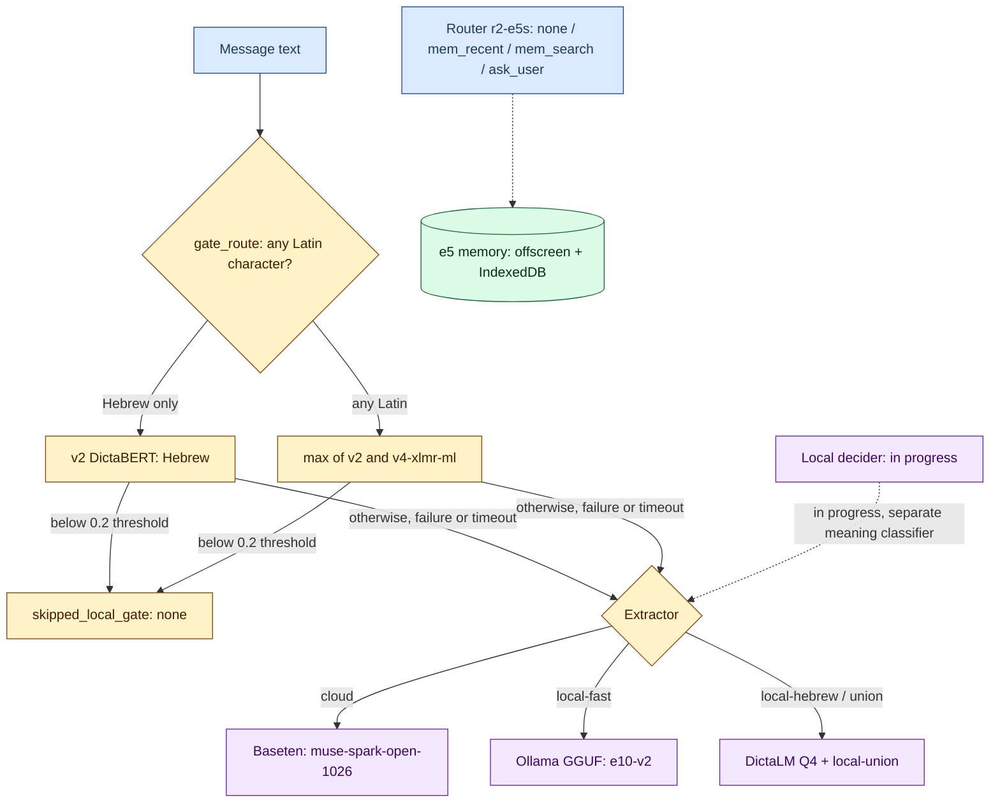

# 07 — Models and machine learning

**Diagram — model map:**

## Gate classifier (fast classifier)

Role: skip an expensive model call when concern probability is low. **Recall-first**: failure/timeout always escalates to the model.

| Item | Value | Source |
|---|---|---|
| Live (since 2026-10-28) | Hebrew only → v2; Latin letter → `max(v2, v4-xlmr-ml)` | [docs/31](../../31-multilingual-routed-gate.md), [`gate_route.py`](../../../classifier/gate_route.py) |
| Threshold | `LHG_GATE_THRESHOLD=0.2`; below → `skipped_local_gate` → `none` | [handler.ts](../../../proxy/src/handler.ts) |
| Deploy | Oracle primary (800ms timeout) → Modal fallback (1500ms) → model | [AGENTS.md](../../../AGENTS.md) |
| Scoring | `max_length 96, strip` — duplicated in `oracle/server.py` and `serve_modal.Gate._score`; change together | [AGENTS.md](../../../AGENTS.md) |

Measured findings (docs/31, `eval_codex_v2` set + holdout):
- Full routed max: total misses **13** vs 22 (v2 alone) and 26 (xlmr alone).
- Every single model trained on translations lost Hebrew-sarcasm recall (6–10 misses vs 1) — even at 2x Hebrew weight. Hence routing, not replacement.
- Oracle: 758/758 match at 0.2, p50 Hebrew 126ms / Latin 234ms. Modal: 758/758, max diff 5e-5.

Evaluation discipline: judge only on an **independent** set (`classifier/gen_eval.py`, different provider/prompt, never trained on). Same-generator scores were optimistic (v1: 0.986 internal vs 0.906 on Codex eval). A set that guided data changes means generate a new one. Run rule: `py -m modal run classifier/eval_candidates.py --runs v2,<run>` (first = baseline). Runbook: `.claude/skills/lhg-gate-evaluation/SKILL.md`.

## Cloud extractor

- Contract: JSON with `proposedFacts` (alias:[bool,quote] in local mode) + `meaning` + `directAssessment` + `needs`. `proposedFacts` are **not** in the `/check` response — measurement uses a temporary eval worker (`wrangler dev --remote`, toml outside the repo). Source: [AGENTS.md](../../../AGENTS.md), `classifier/eval_facts.py`.
- Default: Baseten `muse-spark-open-1026` (via Brain `agent_kind=baseten` on the private path, direct on the public path). See [04](04-check-modes-and-presets.md).
- Every provider must pass a live smoke test under the Worker's 20s timeout before joining the list. Source: [cloudModels.ts](../../../proxy/src/cloudModels.ts).

## Local extractor (Ollama GGUF)

| Engine | Model | Contract | Source |
|---|---|---|---|
| `extractor-7b-q4` | Qwen 7B Q4_K_M, **e10-v2** (replaces e8) | contract v2, 18 facts | [docs/49](../../49-extractor-v2-ollama.md) |
| `dictalm-q4` | DictaLM 2.0 Q4_K_M | contract v1, 8 facts (not retrained to v2) | [docs/49](../../49-extractor-v2-ollama.md) |

- Public GGUFs on HF (`yonicc/lhg-extractor-*-gguf`). Q4_K_M kept valid JSON (0 format errors) vs Torch int8 which corrupted output. Source: [docs/40](../../40-local-extractor-gguf-cpu.md).
- Score = the model's own token probability (`ollama-client.js scoreKeys`: min P of first key token, P of true/false, from `logprobs`; verified live on Ollama 0.40.12). Missing/misaligned means no score, so `factPolicy` rejects. One bad pair is dropped alone; only non-JSON/object output fails entirely. `done_reason:'length'` fails. Source: [AGENTS.md](../../../AGENTS.md), [docs/45](../../45-ollama-local.md).
- Of the 18 contract ids, 6 are `confirmedByUserOnly` only — reported as such, never as unknown IDs. Source: [docs/49](../../49-extractor-v2-ollama.md).

**Parity gate and release (docs/49):** e10-v2 Q4 **failed** the gate (Set A/8 recall 0.6288→0.5939; Set B/18 precision 0.9239→0.8997; bound −0.02). The owner explicitly approved release (option A, 2026-10-29) because Set B/8 precision (0.9259 at recall 0.8427) is far better than e8 (0.596 at similar recall 0.854). The gate is kept for future swaps; `hf_publish_modal.py` requires explicit `--allow-parity-regression` and refuses partial reports.

**Independent set (docs/47, `research/independent-eval-20261029/`):** different-provider generator + second blind labeler; labels frozen by hash before opening the signed file. Never train/calibrate/fix on it. On it: e8 hallucinations (P 0.60) vs e10-v2 P 0.94 on the same 8 facts. Source: [docs/47](../../47-independent-eval-20261029.md).

## Local memory embeddings (e5)

- Quantized `multilingual-e5-small` (dim 384, ~5.5ms/doc in the Node POC). Exact brute-force cosine search to ~20k vectors — no ANN needed at personal scale. Embeddings/index in offscreen only, never in the service worker. Source: [docs/33](../../33-browser-vector-memory.md), [docs/36](../../36-extension-local-memory.md).
- The model downloads explicitly in options (~135MB); inference is cached-only.

## Context router (r2-e5s)

- Owner scope: decides only `none | mem_recent | mem_search | ask_user` (`classifier/router/labels.json` → heads, single mapping in `evaluate.py heads_of`). Retrieval is deterministic code, never a model tool loop. Source: [docs/34](../../34-local-context-router.md), [docs/35](../../35-local-router-evaluation.md).
- Ship: `emb8` only (int8 for the embedding table only); full `quantize_dynamic` corrupted decisions (173/459 flips). Threshold calibration on the shipped artifact. DictaBERT does not load in transformers.js 2.17 (`NFD`). Source: [AGENTS.md](../../../AGENTS.md).
- Integration: [`extension/memory-router*.mjs`](../../../extension/memory-router.mjs) + `builder.mergeMemory`; `lhgRouterEnabled` off by default, requires importing a pinned r2-e5s folder (~191MiB), cached-only. On the independent set r3 did **not** beat r2. Source: [docs/44](../../44-router-memory-integration.md), [docs/47](../../47-independent-eval-20261029.md).

> **Via Brain — open:** the `codex` branch of `/api/v1/chat/completions` drops `system_prompt` (fix in progress, 2026-10-26); until verified — put instructions in the user turn for `agent_kind=codex`. Source: [AGENTS.md](../../../AGENTS.md). Current status unverified.
