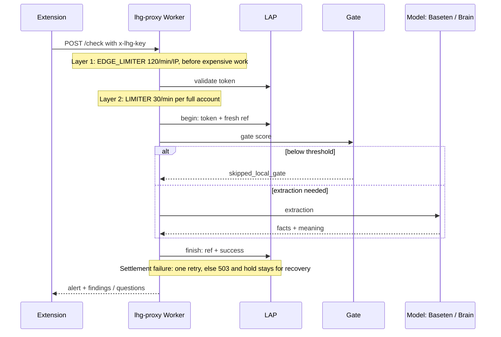

# 08 — Security, billing and ops

## Auth

| Mechanism | Details | Source |
|---|---|---|
| `lap_...` token (public) | Managed at `https://lhg.ysho.uk` (legacy `lap.ysho.uk` redirects); revoke/grants/balance/daily quota enforced centrally in LAP | [accountAccess.ts](../../../proxy/src/accountAccess.ts), [AGENTS.md](../../../AGENTS.md) |
| Legacy access key (private) | Valid for the owner's existing install; full model picker | [docs/50](../../50-public-distribution.md) |
| `LHG_PUBLIC_CHECK` | Derived **server-side only** after `lap_` auth — request body/headers cannot choose privilege. No Baseten key means fail-closed, never a Brain fallback | [handler.ts](../../../proxy/src/handler.ts#L208), [docs/50](../../50-public-distribution.md) |
| Key comparison | constant-time `sameKey` (accumulating XOR) for the access key | [handler.ts](../../../proxy/src/handler.ts#L163) |

The extension sends `x-lhg-key`; `401 → not_configured`, `429 → not_checked (rate_limited)`. Source: [background.js](../../../extension/background.js).

## Rate limits (two stages, before expensive work)

```text
POST /check|/warm → EDGE_LIMITER 120/min/IP (cf-connecting-ip only)
  → LAP validate → LIMITER 30/min/full account (all tokens/devices share)
  → begin/reservation → gate → extraction
```

- `EDGE_LIMITER` is consumed **before** central calls; `LIMITER` after validate and before reservation/gate. Legacy keys also consume `LIMITER`. Source: [AGENTS.md](../../../AGENTS.md).
- Cloudflare limits are approximate per-location admission controls, **not** a global financial cap — the central daily quota is authoritative.
- Limiter error → `503 limiter_unavailable`; refusal → `429 rate_limited` with `retry-after: 60`. Source: [throttle.ts](../../../proxy/src/throttle.ts).
- Cookie Max-Age alone is not server-side session expiry. Review: [docs/27-security-review.md](../../27-security-review.md).

**Diagram — reservation, settlement and rate-limit layers:**



## Billing — reservation / settlement

Flow in [accountAccess.ts](../../../proxy/src/accountAccess.ts): `validate` → (for `/check`) `begin {token, ref=randomUUID}` → check → `finish {ref, success}`. `success` iff `status in {extracted, skipped_local_gate}`. `finish` is idempotent per ref; a settlement failure (5xx) is retried once, then `503 settlement_unavailable` and the hold stays for admin recovery. **Every needs/clarification round = a new, separately billed request.** Source: [docs/48](../../48-cloud-context-loop.md).

Request bounds: text <=2000 chars (`413 text_too_long`), `userNote` <=500 (truncated, not rejected), `confirmedFacts` catalog ids <=20. Source: [limits.ts](../../../proxy/src/limits.ts), [handler.ts](../../../proxy/src/handler.ts).

## Secrets (names only — no values)

Worker secrets: `LHG_ACCOUNT_KEY`, `LHG_BASETEN_KEY`, `LHG_BRAIN_TOKEN`, `LHG_ACCESS_KEY`, `LHG_GATE_KEY`, `LHG_GATE_ORACLE_KEY`. The Modal secret `lhg-gate` (`GATE_KEY`) equals `LHG_GATE_KEY`; the Oracle `GATE_KEY` in `/home/ubuntu/lhg-gate/gate.env` equals `LHG_GATE_ORACLE_KEY`. Upload only via `wrangler secret bulk <json outside the repo>` — `secret put` in PowerShell 5.1 silently stores a wrong value. Source: [AGENTS.md](../../../AGENTS.md).

Every Worker server call: `redirect:'manual'` + explicit 3xx rejection (Workers does not implement `redirect:'error'` — it throws before the request). Never follow a redirect with partner credentials. Source: [accountAccess.ts](../../../proxy/src/accountAccess.ts#L10), [baseten.ts](../../../proxy/src/baseten.ts).

## Deploy and release (3 places — owner rule 2026-10-27)

Every extension release requires all three; part of "done", not optional. Bump `version` in the manifest, commit, push, then:

1. **BI-1**: `scripts\release-extension.ps1` — refuses unless `HEAD == origin/main` and `extension/` is clean; runs tests; publishes the exact commit to LAP (TZ `package-extension.py <sha>`) and verifies live that `/downloads/version.json` and the ZIP SHA-256 match.
2. **YONI-PC**: `bash scripts/install-from-lap.sh` — installs the verified ZIP to `/home/yoni/lashon-hara-guard-gmail/extension` (backup kept). BI-1 has no SSH path to YONI-PC — the step runs there.
3. The user reloads the extension and refreshes the tab.

Worker deploy: `npx wrangler deploy` from BI-1 (logged in as yonicc). Gate deploy: Oracle `bash deploy.sh <tag> v4-xlmr-ml` (no second argument = Hebrew-only rollback); test the new image on side port 8091 before swapping. Source: [AGENTS.md](../../../AGENTS.md), [docs/31](../../31-multilingual-routed-gate.md).

## Known operational debt

- **Retry double-charge** (explicitly deferred in docs/50): every `/check` creates a new ref; a transport retry after a lost response bills twice. Future fix: a stable client operation ID. See [09](09-decisions-and-debt.md).
- No `min_containers` on Modal without a user decision (always-on ≈ $2.6/day).
- Files copied from BI-1 to Oracle are CRLF — convert to LF on the host first.
