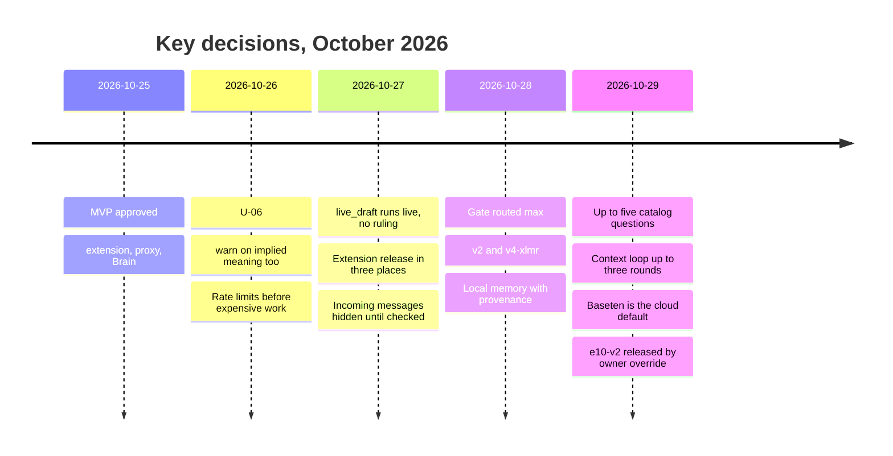

# 09 — Decisions, open questions and technical debt

## Key decisions (short ADR)

| Date | Decision | Source |
|---|---|---|
| 2026-10-25 | MVP build approved: extension → proxy → Brain | [docs/06-decisions.md](../../06-decisions.md), [AGENTS.md](../../../AGENTS.md) |
| 2026-10-26 | U-06: also warn on meaning that could be read as disparaging, without an explicit disparaging word | [docs/06-decisions.md](../../06-decisions.md) |
| 2026-10-26 | MVP runtime: EDGE 120/min + LIMITER 30/min before expensive work | [AGENTS.md](../../../AGENTS.md) |
| 2026-10-27 | Incoming: hidden until checked; failure/warning → hidden until explicit Show | [docs/15](../../15-incoming-hold.md) |
| 2026-10-27 | `live_draft`: the draft pack runs live; no ruling, no "permitted", only warn/questions | [docs/18](../../18-toelet-rules.md) |
| 2026-10-27 | Extension release = 3 places (BI-1, lhg.ysho.uk, YONI-PC) | [AGENTS.md](../../../AGENTS.md) |
| 2026-10-28 | Live gate: routed max (v2 / max(v2, xlmr)) — not a model swap | [docs/31](../../31-multilingual-routed-gate.md) |
| 2026-10-28 | Local memory: all text from diagnosed fields (incl. unsent drafts), provenance kept | [docs/35](../../35-local-memory-ingestion-and-browser-test.md) |
| 2026-10-29 | Question quota 1 → up to 5; contract broken without backward compatibility | [docs/41](../../41-five-question-contract.md), [docs/18](../../18-toelet-rules.md) |
| 2026-10-29 | Shared cloud/local context loop, up to 3 rounds, each round billed | [docs/48](../../48-cloud-context-loop.md) |
| 2026-10-29 | Cloud default: Baseten `muse-spark-open-1026` (both builds) | [cloudModels.ts](../../../proxy/src/cloudModels.ts) |
| 2026-10-29 | Public: direct Baseten only; `LHG_PUBLIC_CHECK` server-side only | [docs/50](../../50-public-distribution.md) |
| 2026-10-29 | Outgoing never captures send; explicit bypass on second send | [AGENTS.md](../../../AGENTS.md), [compose-watch.js](../../../extension/compose-watch.js) |
| 2026-10-29 | e10-v2 Q4 released despite parity failure (owner option A) | [docs/49](../../49-extractor-v2-ollama.md) |
| 2026-10-29 | Technical-debt register `docs/TECH-DEBT.md`; extractor meaning training kept separate from the decider | [docs/TECH-DEBT.md](../../TECH-DEBT.md) |

Full U-01..U-07 decisions: [docs/06-decisions.md](../../06-decisions.md).

**Diagram — decision timeline:**

## Open questions (from docs/06 — undecided)

1. Hard stop vs skippable clarification in the undecided state (question 1).
2. Who certifies halakhic/legal rules and the jurisdiction (question 3) — expert review of drafts still pending.
3. Sensitive relation retention: permission, duration, sync (question 4).
4. Disputed halakhic profile and its presentation (question 6).
5. Interruption budget and long-term question cap (R-02); false-alert target (I-04, proposal: <5%).
6. Dual direct-AI vs engine control (R-01) — unverified whether implemented.

## Known technical debt

| Debt | Severity | Source |
|---|---|---|
| Transport retry can bill twice (new ref per `/check`); explicitly deferred by the owner | financial | [docs/50](../../50-public-distribution.md) |
| `local-union` is not an independently measured quality gain over Qwen v2 | quality | [docs/49](../../49-extractor-v2-ollama.md) |
| Local extractor not trained with context — follow-up-round snippets are untrusted with no parity claim | quality | [docs/48](../../48-cloud-context-loop.md) |
| DictaLM stays on contract v1 (8 facts) — no v2 training | coverage | [docs/49](../../49-extractor-v2-ollama.md) |
| The six `confirmedByUserOnly` facts — never from the model | coverage | [docs/49](../../49-extractor-v2-ollama.md) |
| No scheduled expiry for conversation/participant/fact/relation records in `lhg-context` | privacy | [PRIVACY.md](../../../PRIVACY.md#L16) |
| Provider retention (Baseten/Brain/Oracle) unverified | privacy | [PRIVACY.md](../../../PRIVACY.md#L39) |
| `meaning` field in the local extractor contract (concern/mechanism/verbatim quote) — approved future work, not implemented | quality | [docs/TECH-DEBT.md](../../TECH-DEBT.md) |
| Old-generation DictaLM union with e10-v2 not re-measured — do not publish the old union measurement for the new pair | quality | [docs/TECH-DEBT.md](../../TECH-DEBT.md) |
| Local decider (separate meaning classifier) — **in progress**; does not complete the extractor contract | docs | [docs/TECH-DEBT.md](../../TECH-DEBT.md) |

## Inconsistencies found between docs and code (for supervisor review)

1. **Cloud-model path in cloudModels vs handler:** `pickCloudModel` returns the default for every absent/unknown, but `handler.providerFromEnv` with `choice=null` returns the env provider — verify the caller always passes the `pickCloudModel` result (partially verified; the full absent path in the reviewed handler code is unverified).
2. **Pack count:** docs/18 writes "eleven packs and 234 reminders" while AGENTS.md says "eight source-linked reminder packs" for `CC_ALL_DRAFT_PACK` — unify the count (packs vs sub-packs).
3. **Extension version in old docs:** 0.10/0.11 docs refer to behaviors (e.g. panel shortcut `Ctrl+Shift++`) replaced by the native `Ctrl+Shift+L` — the historical docs are not all marked superseded.
4. **Stale root README:** still describes "extension/engine not yet built" and lists only docs/01–08, while the system is live at 0.14.0.
