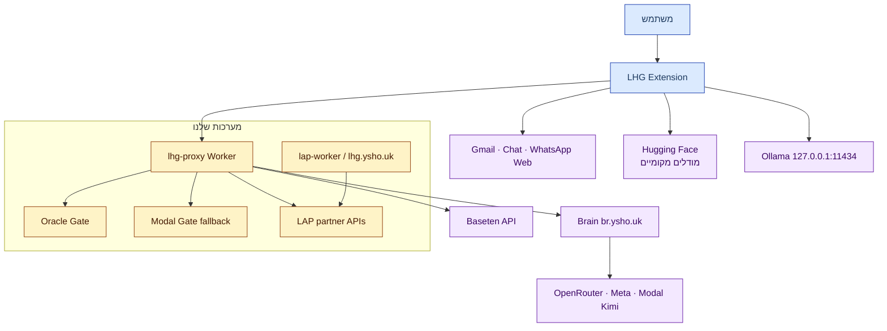

# 01 — הקשר מערכת (C4 Level 1)

## מטרה

LHG (Lashon Hara Guard) מתריע לפני שליחה וליד הודעות נכנסות כאשר טקסט עלול להתפרש כגנאי, לפי חבילת טיוטה מחפץ חיים (`CC_ALL_DRAFT_PACK`, מצב `live_draft`). אין פסיקה: פלט העל הוא `alert ∈ {warn, unsure, none, not_checked}` בלבד, והבית היחיד שלו הוא [`alertFor` ב־handler.ts](../../../proxy/src/handler.ts#L131). מקור: [docs/18](../../18-toelet-rules.md).

## שחקנים

| שחקן | תיאור | מקור |
|---|---|---|
| משתמש קצה (ציבורי) | מתקין מ־`https://lhg.ysho.uk`, טוקן `lap_...`, חיוב LAP | [docs/50](../../50-public-distribution.md) |
| משתמש פרטי (הבעלים) | legacy access key, picker מודלים מלא | [check-mode.js](../../../extension/check-mode.js#L33) |
| מנהל/אדמין LAP | שחזור holds, ניהול יתרות (ידני) | [accountAccess.ts](../../../proxy/src/accountAccess.ts) |
| רב / מומחה הלכה | סקירת draft packs עתידית; קבוצה D = הפניה בלבד | [docs/42](../../42-rabbi-referral-artifact.md) |

דרישות U-03/U-04: סריקת נכנסות היא דרישת ליבה; פלטפורמות יעד הן WhatsApp Web, Gmail, Google Chat. מקור: [docs/06-decisions.md](../../06-decisions.md).

## מערכות חיצוניות

| מערכת | תפקיד | מקור |
|---|---|---|
| Cloudflare Workers | `lhg-proxy` — נקודת הכניסה היחידה מהתוסף | [proxy/src/handler.ts](../../../proxy/src/handler.ts#L23) |
| Oracle (`82.70.209.225`) | gate ראשי, container `lhg-gate`, `127.0.0.1:8090`, tunnel `/lhg-gate/*` | [AGENTS.md](../../../AGENTS.md), [docs/16](../../16-gate-oracle.md) |
| Modal | gate fallback (`serve_modal.py`, v2 fp32); אימון extractor/router | [docs/12](../../12-gate-classifier.md) |
| Brain (`br.ysho.uk/dash`) | נתיב completions למודלי ענן (meta_api/openrouter/modal), `muse-spark-1.3`, `reasoning_effort=minimal` | [AGENTS.md](../../../AGENTS.md), [docs/10](../../10-brain-send-backend.md) |
| Baseten | `meta-models/muse-spark-open-1026` — ברירת מחדל + נתיב ציבורי ישיר | [baseten.ts](../../../proxy/src/baseten.ts) |
| LAP / TZ (`lhg.ysho.uk`) | tokens, יתרות, begin/finish; אתר הורדות + ניהול טוקנים | [accountAccess.ts](../../../proxy/src/accountAccess.ts) |
| Hugging Face | GGUF ציבוריים: `yonicc/lhg-extractor-*-gguf`; מודלי e5/router (~135MB) | [AGENTS.md](../../../AGENTS.md) |
| Ollama (מקומי) | הסקת extractor מקומי, `127.0.0.1:11434` | [docs/45](../../45-ollama-local.md) |

## גבולות אמון

1. **דפדפן ↔ Worker**: רק `x-lhg-key` (`lap_...` או legacy key). התוסף לעולם לא רואה את Brain/Baseten token — הם Worker secrets. מקור: [background.js](../../../extension/background.js#L1).
2. **Worker ↔ LAP**: `LHG_ACCOUNT_KEY` (secret, שמות בלבד — ללא ערכים). ללא טקסט הודעות לשירות החשבונות. מקור: [accountAccess.ts](../../../proxy/src/accountAccess.ts#L5).
3. **Worker ↔ ספקי מודל**: כל ה־server calls עם `redirect:'manual'` ודחיית 3xx — credentials לעולם לא עוקבים אחרי redirect. מקור: [AGENTS.md](../../../AGENTS.md).
4. **תוכן לא מהימן**: קטעי context/memory הם `candidate/dom_observed` — לעולם לא `confirmedFacts`/evidence. מקור: [docs/48](../../48-cloud-context-loop.md).
5. **מודל ↔ כלים**: המודל בוחר רק בקשות קריאה מוגבלות (`get_recent`/`search_history`) ו־fact ids מהקטלוג; scope/חשבון/שיחה נקבעים בקוד. מקור: [engine/src/needs.ts](../../../engine/src/needs.ts).

> ⚠️ גבול פתוח: `PRIVACY.md` מציין במפורש — אין הבטחת zero-retention אצל ספקים במעלה השרשרת (לוגים, שימוש לאימון). לא אומת retention של Baseten/Brain בפועל. מקור: [PRIVACY.md](../../../PRIVACY.md#L39).
