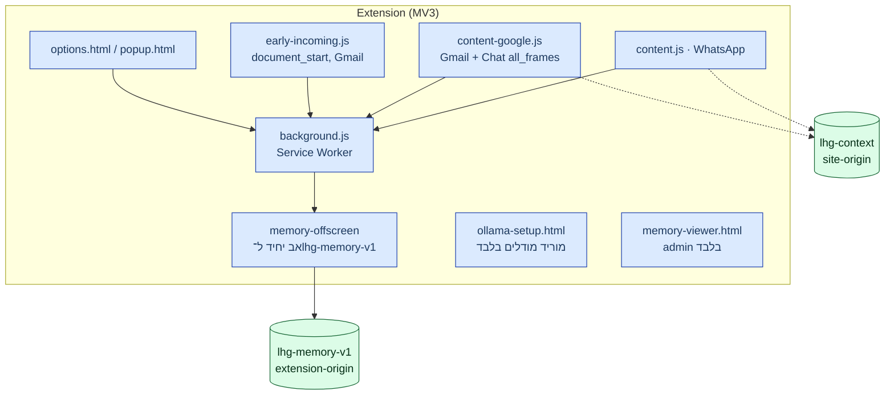

# 02 — מכולות (C4 Level 2)

## תוסף Chrome MV3 (גרסה 0.14.0)

מקור: [extension/manifest.json](../../../extension/manifest.json) — `minimum_chrome_version: 116`, permissions: `storage, tabs, offscreen`.

| רכיב | אחריות | מקור |
|---|---|---|
| `content.js` (WhatsApp) | סריקת נכנסות/יוצאות, panel, compose-watch | [manifest.json](../../../extension/manifest.json#L29) |
| `content-google.js` | Gmail + Google Chat; `all_frames:true` כי Chat רץ ב־iframe `chat.google.com` | [manifest.json](../../../extension/manifest.json#L36), [AGENTS.md](../../../AGENTS.md) |
| `early-incoming.js` | CSS guard ב־`document_start` ל־Gmail — הסתרת נכנסות לפני בדיקה | [docs/15](../../15-incoming-hold.md) |
| `background.js` | **היחיד שמדבר עם הרשת**; ניתוב local/cloud, לולאת needs, cache | [background.js](../../../extension/background.js#L1) |
| `memory-offscreen.mjs` | בעלים יחיד של הזיכרון המרכזי; e5 embeddings (WASM); מחיקה/תפוגה | [docs/36](../../36-extension-local-memory.md) |
| `ollama-setup.html` | **המבקש היחיד המורשה** ל־`/api/pull` (sender URL מדויק); סגירה = ביטול setup | [docs/45](../../45-ollama-local.md) |
| `memory-viewer.html` | stats/list/search/delete — רק מ־`options.html`/`memory-viewer.html` (URL מדויק) | [memory-background.js](../../../extension/memory-background.js) |

בחירת selectors ל־WhatsApp רק ב־[selectors.js](../../../extension/selectors.js); כיוון הודעה רק ב־`S.isOutgoing` שם. מקור: [AGENTS.md](../../../AGENTS.md).

## Worker proxy (`lhg-proxy`)

| מודול | תפקיד |
|---|---|
| [handler.ts](../../../proxy/src/handler.ts) | `POST /check`, `POST /warm`; `alertFor` — בית יחיד לרמת ההתראה |
| [accountAccess.ts](../../../proxy/src/accountAccess.ts) | validate → LIMITER → begin (reservation) → check → finish (settlement) |
| [cloudModels.ts](../../../proxy/src/cloudModels.ts) | allow-list מודלים; default = Baseten Spark |
| [baseten.ts](../../../proxy/src/baseten.ts) | `BasetenExtractorProvider` — נתיב ציבורי ישיר, מודל קבוע שרתית |
| [throttle.ts](../../../proxy/src/throttle.ts) | fail-closed: שגיאת limiter → 503, סירוב → 429 |
| [limits.ts](../../../proxy/src/limits.ts) | `MAX_TEXT_CHARS=2000`; הגבלות נוספות מ־engine |

זרימה: `EDGE_LIMITER (120/min/IP)` → `personalCheck` (LAP) → `LIMITER (30/min/account)` → gate → extraction → rules. מקור: [AGENTS.md](../../../AGENTS.md), [docs/27](../../27-security-review.md).

## Gate (Oracle ראשי / Modal fallback)

- חוק ניתוב יחיד: [`classifier/gate_route.py`](../../../classifier/gate_route.py) — עברית בלבד → v2; כל אות לטינית → `max(v2, v4-xlmr-ml)`. מיובא גם ב־`oracle/server.py` וגם ב־`serve_modal.py`.
- `p < LHG_GATE_THRESHOLD (0.2)` מדלג על המודל; כשל/timeout ב־gate **תמיד** מסלים למודל — ה־gate רק חוסך, לעולם לא מסתיר. מקור: [AGENTS.md](../../../AGENTS.md).
- Oracle: container `lhg-gate` (cores 2–3, 3GiB), `127.0.0.1:8090`. Modal: fallback, Volume `lhg-models`.

## שירותים נוספים

| שירות | תפקיד |
|---|---|
| Brain (`br.ysho.uk/dash`) | completions סטטלסיים לנתיב הפרטי (`meta_api`/`openrouter`/`modal` בלבד; `claude`/`codex` מודרים — מריצים CLI עם כלים) — [cloudModels.ts](../../../proxy/src/cloudModels.ts#L9) |
| LAP/TZ (`lhg.ysho.uk`) | tokens `lap_...`, grants, יתרות, quota יומית; הורדת תוסף ציבורי — [docs/13](../../13-lap-access.md) |
| `lap-worker` | אתר ציבורי: ניהול טוקנים אישיים + `/downloads/` לתוסף — [AGENTS.md](../../../AGENTS.md) |
| Ollama (מקומי) | `127.0.0.1:11434`, GGUF Q4_K_M דרך `ollama-client.js` — [docs/45](../../45-ollama-local.md) |

> **עדכון main (`a33cfd6`):** מסמך החוב [docs/TECH-DEBT.md](../../TECH-DEBT.md) כבר על `origin/main` — ר׳ [09](09-decisions-and-debt.md). ה־decider המקומי (מסווג meaning נפרד) עדיין **בתהליך** לפי אותו מסמך; אינו משלים את עבודת חוזה ה־extractor ואינו מתיר עובדות חסרות כ־false.
