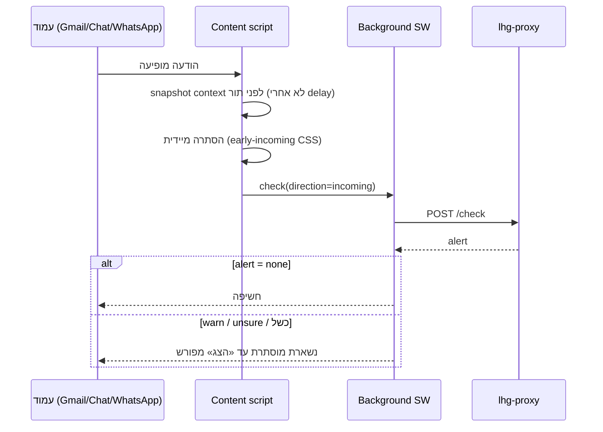

# 03 — זרימות בדיקה

## חוזה `/check` (קנוני: docs/18)

בקשה: `text, platform, direction, context?, confirmedFacts?, userNote?(≤500), lang?, model?, round?(1–3)`. תשובה: `alert, status, analysis?, rules?, needs?, gate?, model?`. חוזה הלולאה ב־[`engine/src/needs.ts`](../../../engine/src/needs.ts): עד 2 בקשות (`get_recent {n≤20}` / `search_history {query≤300, top_k≤5}`) ועד 5 שאלות קטלוג. כל סבב = `/check` חדש ומחויב בנפרד. מקור: [docs/48](../../48-cloud-context-loop.md), [docs/18](../../18-toelet-rules.md).

## בדיקת טיוטה יוצאת (compose)

```mermaid
sequenceDiagram
  actor U as משתמש
  participant CS as Content script
  participant BG as Background SW
  participant PX as lhg-proxy
  participant GT as Gate
  participant EX as Extractor
  U->>CS: לחיצת Send / Enter
  CS->>BG: check(text, context, round=1)
  BG->>PX: POST /check (x-lhg-key)
  PX->>PX: EDGE 120/min → LAP validate → LIMITER 30/min → begin
  PX->>GT: score(text)
  alt p < 0.2 ואין needs פתוח
    GT-->>PX: skipped_local_gate
  else
    PX->>EX: extraction (text + context + userNote)
    EX-->>PX: facts + meaning + needs
    PX->>PX: runLiveRules → alertFor
  end
  PX->>PX: finish (settlement)
  PX-->>BG: alert + rules/needs
  alt needs פתוח וזיכרון פעיל (≤3 סבבים)
    BG->>BG: שליפה scoped, מיסוך, sanitizeContextPacket
    BG->>PX: POST /check (round+1, חיוב חדש)
  end
  BG-->>CS: תוצאה / שאלות
  CS-->>U: Send anyway זמין מיד; שליחה שנייה = bypass
```

כללים קריטיים (מקור: [AGENTS.md](../../../AGENTS.md), [compose-watch.js](../../../extension/compose-watch.js)):

- **יוצאות לעולם לא לוכדות send** (החלטת בעלים 2026-10-29): ״שלח בכל זאת״ מוצג מיד בזמן הבדיקה; שליחה native שנייה עוקפת במפורש. ה־bypass מבטל liveness לפני replay — תשובה מאוחרת לא שולחת שוב ולא פותחת סבבי הקשר.
- הקלדה לבדה לא מפעילה בדיקה; רק ניסיון שליחה או בדיקה ידנית (Ctrl+Shift+L / panel).
- Gmail: click ו־Ctrl+Enter; Chat/WhatsApp: click/Enter (`compose-watch.js` משותף). Progress לא־מוגדר (indeterminate).
- שאלות נשלחות רק בלחיצת ״שלח תשובות ובדוק מחדש״ — בחירה לבדה אינה בקשה ואינה חיוב ([docs/41](../../41-five-question-contract.md)).

## בדיקת הודעה נכנסת



מדיניות (החלטת בעלים 2026-10-27, [docs/15](../../15-incoming-hold.md)): נכנסת מוסתרת עד שעברה בדיקה; כשל או אזהרה ⇒ מוסתרת עד לחיצה מפורשת. נכנסות לעולם לא מציגות popup — רק תג inline; ה־panel הידני ב־Ctrl+Shift+L. מקור: [AGENTS.md](../../../AGENTS.md).

הערות יישום: history של Gmail נבנה מחדש לכל בדיקה ומצולק לפני התור (החלפת שיחה לא משנה בקשה ממתינה); Own echoes שומרים כיוון לפי DOM node+text ל־20 שניות (`LHG_COMPOSE.recentlySent`). מקור: [extension/GMAIL-CHECKS.md](../../../extension/GMAIL-CHECKS.md).

## לולאת הקשר (cloud + local, מקס׳ 3 סבבים)

מבוצעת ב־[`extension/context-loop.js`](../../../extension/context-loop.js) (background, מסלול משותף):

1. סבב 1 רגיל. אם `needs.requests/questions` ריק — סיום.
2. שליפה דרך memory bridge לפי ה־scope שנלכד (חשבון+שיחה): `get_recent` / `search_history`, timeout שליפה 5s.
3. מיסוך (שמות/מייל/טלפון) ב־content frame המקורי (`builder.mergeMemory`), ואז `sanitizeContextPacket` ב־background.
4. סבב הבא עם הקטעים (תקציב משותף 5×300) — כנתונים לא מהימנים, לעולם לא `confirmedFacts`.
5. עצירה: 3 בדיקות, חזרה/אין קטעים חדשים, זיכרון כבוי, scope חסר, שגיאה. כשל שומר את התוצאה/שאלות האחרונות — לעולם לא אישור. לולאות pending/stopped לא נכנסות למטמון.

מקור: [docs/48](../../48-cloud-context-loop.md).

## מצבים מקומיים + fallback + union

- `local-fast` (7B Q4) / `local-hebrew` (DictaLM Q4) / `local-union` (שניהם): extractor צר `alias:[bool,quote]` בלבד — ללא הערכת meaning; תוצאה נשארת unresolved. מקור: [docs/45](../../45-ollama-local.md), [docs/49](../../49-extractor-v2-ollama.md).
- מנוע לא זמין ⇒ `not_checked (local_unavailable)`; לענן רק אם `lhgCloudFallback=true`. לעולם לא `none` שקט. מקור: [check-mode.js](../../../extension/check-mode.js).
- במצב local, ה־needs נגזר מ־router heads (`mem_recent→get_recent`, `mem_search→search_history` בשאילתת ההודעה, `ask_user→`שאלות קטלוג) + עובדות קטלוג לא־נענות של המנוע. Router כבוי כברירת מחדל; חסר/כושל ⇒ שאלות דטרמיניסטיות בלבד.

## מטמון תוצאות

אחסון מקומי בתוסף, מפתח = SHA-256 של (חשבון, מזהה הודעה/שיחה, תוכן, context, תצורת בדיקה כולל mode/model). שימוש חוזר עד 14 יום, עד 500 רשומות. שגיאות לעולם לא נשמרות כהצלחה; ״בדוק שוב״ עוקף מטמון. מקור: [background.js](../../../extension/background.js), [PRIVACY.md](../../../PRIVACY.md#L14).
