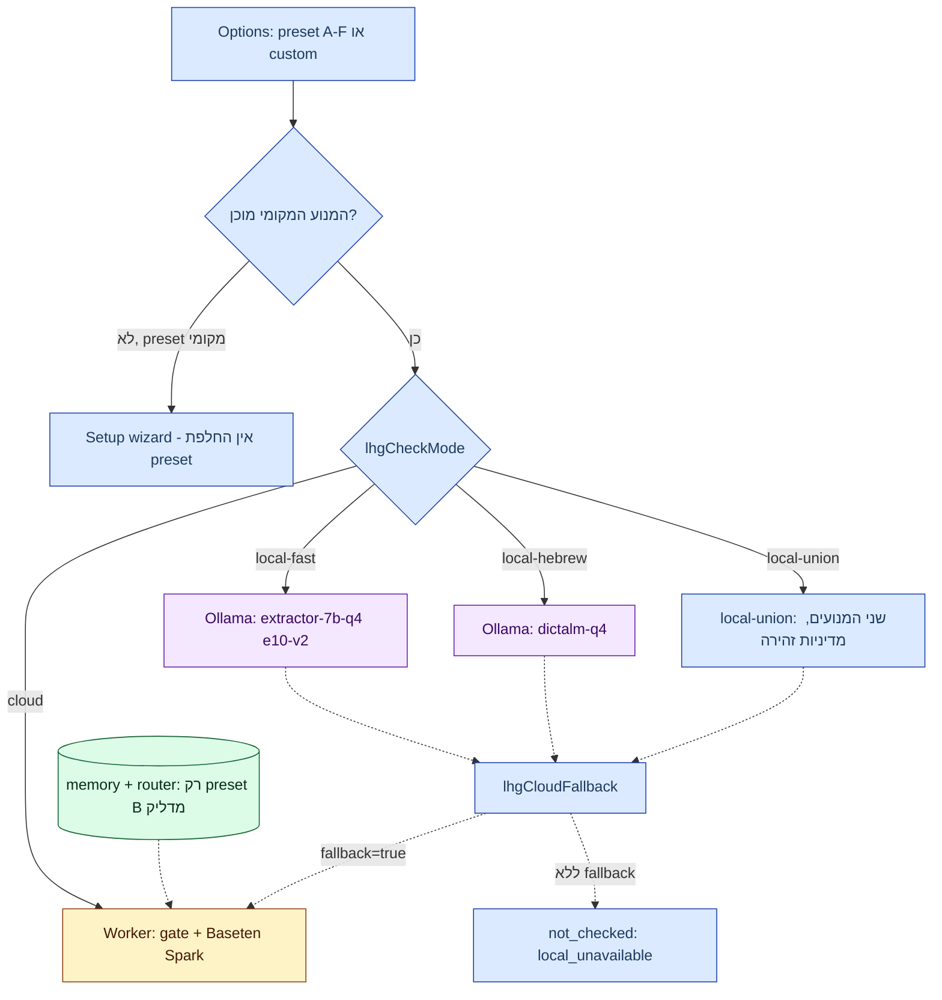

# 04 — מצבי בדיקה ו־Presets

## בית יחיד

- [`extension/check-mode.js`](../../../extension/check-mode.js) — ה־home היחיד של `lhgCheckMode`, `lhgCloudFallback`, `lhgCloudModel` וממשק המנועים המקומיים (`registerLocalEngine`).
- [`extension/check-presets.js`](../../../extension/check-presets.js) — ה־home היחיד של רשת ה־presets; `options.js` רק מרנדר, `preset-grid.css` רק מעצב.

**תרשים — מה־preset אל המנוע:**

## מצבים (`lhgCheckMode`)

| מצב | מנוע | התנהגות בכשל |
|---|---|---|
| `cloud` (ברירת מחדל) | Worker → gate → מודל ענן | `not_checked` בשגיאת רשת/HTTP |
| `local-fast` | `extractor-7b-q4` (Qwen 7B Q4_K_M, e10-v2) | `local_unavailable` אלא אם fallback |
| `local-hebrew` | `dictalm-q4` (DictaLM Q4, contract v1) | כנ״ל |
| `local-union` | שני המנועים, מדיניות זהירה (alert/needs) | כנ״ל |

מצב מקומי שאינו יכול לרוץ הוא `not_checked (error:'local_unavailable')` — לעולם לא `none` ולעולם לא מעבר שקט לענן. מקומיים מחלצים עובדות בלבד (ללא meaning assessment) — התוצאה נשארת unresolved. מקור: [check-mode.js](../../../extension/check-mode.js), [docs/45](../../45-ollama-local.md).

## רשת Presets ‏2×3

עמודות: `cloud | combined | local`; שורות: `fast | accurate`. כל preset הוא רק שילוב נקוב של המתגים הקיימים. רמות 1–5 (גבוה = טוב יותר; cost 5 = חינם).

| ID | עמודה/שורה | mode | fallback | memory+router | מהירות/דיוק/פרטיות/עלות |
|---|---|---|---|---|---|
| A | cloud/fast | cloud | false | false | 5/3/2/2 |
| B | cloud/accurate | cloud | false | true | 4/5/1/2 |
| C | combined/fast | local-fast | true | (לא נוגע) | 3/2/4/4 |
| D | combined/accurate | local-union | true | (לא נוגע) | 2/3/4/4 |
| E | local/fast | local-fast | false | (לא נוגע) | 3/2/5/5 |
| F | local/accurate | local-union | false | (לא נוגע) | 2/3/5/5 |

מקור: [check-presets.js](../../../extension/check-presets.js#L21), בדיקות: [check-presets.test.cjs](../../../extension/check-presets.test.cjs).

התנהגויות חשובות:
- מודל הענן **לעולם לא** משתנה על ידי preset (`patchFor` לא נוגע בו).
- Preset מקומי שהמנועים שלו לא מוכנים פותח את setup wizard ולא מתחלף — החלפה הייתה משאירה כל הודעה `not_checked`. מקור: `needsInstall` ב־[check-presets.js](../../../extension/check-presets.js).
- `presetOf` מחזיר `null` (״custom״) כשאין התאמה מלאה; ב־presets מקומיים שדה ה־memory נשאר כבחירת המשתמש ב־Advanced.

## מודלי ענן

Allow-list כפולה — לקוח ([check-mode.js](../../../extension/check-mode.js) `CLOUD_MODELS`) ושרת ([cloudModels.ts](../../../proxy/src/cloudModels.ts) — השער האמיתי). `proxy/test/cloudModels.test.ts` נכשל כשהרשימות שונות.

| | פרטי (legacy key) | ציבורי (`lap_...`) |
|---|---|---|
| רשימה | 12 מודלים (Baseten, Meta, OpenRouter, Modal Kimi) | **רק** `muse-spark-open-1026` (Baseten ישיר) |
| ברירת מחדל | Baseten Spark — שולח **ללא** שדה `model` | קבוע שרתית (`LHG_PUBLIC_CHECK` נגזר רק מ־accountAccess) |
| שדה `model` בתשובה | רק אם הבקשה שלחה אחד | מתעלמים מהרשימה |

מקור: [cloudModels.ts](../../../proxy/src/cloudModels.ts), [docs/50](../../50-public-distribution.md).

ברירת המחדל הנוכחית (בעלים 2026-10-29): Baseten `muse-spark-open-1026` בשני ה־builds. `pickCloudModel` ממפה absent/unknown/default אליו — גם תוספים ישנים עוברים. `muse-spark-1.3` נשאר כניסה מפורשת ב־`meta_api`. Brain `agent_kind=baseten` ענה בכ־1.2s (2026-10-29). מקור: [cloudModels.ts](../../../proxy/src/cloudModels.ts#L53), [AGENTS.md](../../../AGENTS.md).

רק ענפי Brain סטטלסיים מותרים (`meta_api`, `openrouter`, `modal`). מועמדים שנכשלו ב־smoke תחת timeout של 20s ב־Worker (deepseek, kimi, glm, gpt-oss) אינם ברשימה — ראו כותרת [cloudModels.ts](../../../proxy/src/cloudModels.ts).

## מיגרציית ברירת מחדל

`migrateDefault` ב־[check-mode.js](../../../extension/check-mode.js#L73): מעבר חד־פעמי `muse-spark-1.3 → muse-spark-open-1026`, marker `lhgCloudDefaultV=2`. נדרש כי שמירת כל מצב שמרה גם את ברירת המחדל הישנה; בחירת 1.3 מחדש אחרי המיגרציה נשמרת. ה־public build מרנדר רק את Baseten (prepend של `LHG_PUBLIC_BUILD=true` ל־check-mode.js; לעולם לא מותקן מעל עץ המקור של הבעלים). מקור: [docs/50](../../50-public-distribution.md).
