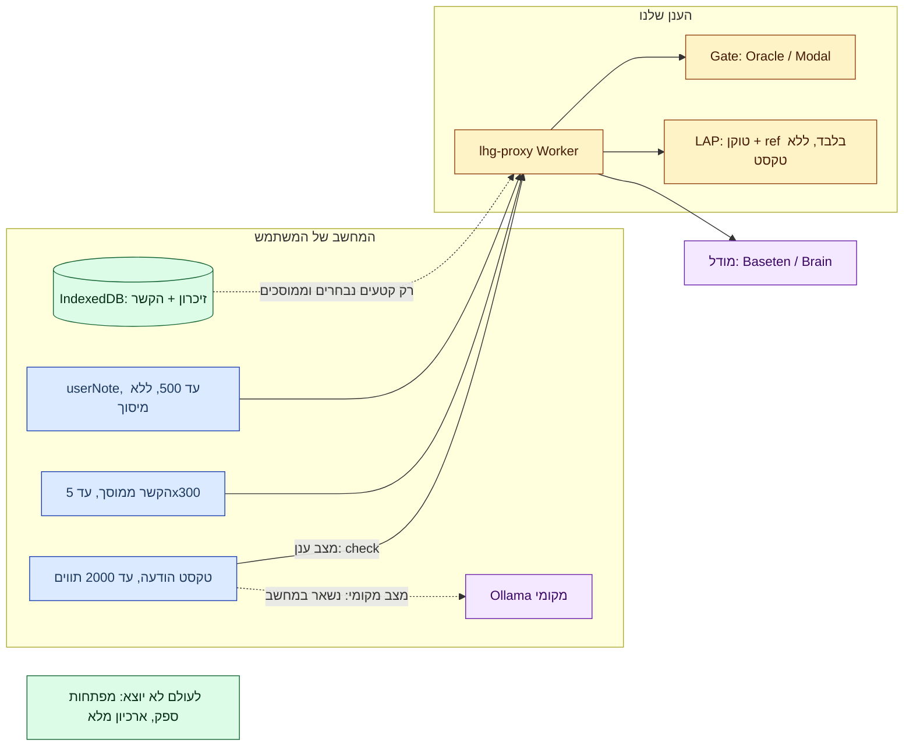

# 05 — נתונים ופרטיות

> מקור מבוקר: [PRIVACY.md](../../../PRIVACY.md) (עודכן 2026-10-29). **לעולם אין לטעון שהכול נשאר מקומי**: `/check` שולח טקסט הודעה, הקשר ו־`userNote` לעיבוד מרוחק; רשומות חשבון/חיוב מרוחקות.

**תרשים — זרימת נתונים וגבולות אמון לפי מצב:**

## מה עוזב את המחשב, לאן

| נתון | יעד | תנאי | מקור |
|---|---|---|---|
| טקסט הודעה (עד 2000 תווים) | Worker → gate; ואם צריך, מודל | כל `/check` ענני | [limits.ts](../../../proxy/src/limits.ts), [handler.ts](../../../proxy/src/handler.ts) |
| קטעי הקשר (עד 5×300) | מודל החילוץ | אם נשלח `context` | [contextPacket.ts](../../../engine/src/contextPacket.ts) |
| `userNote` (עד 500, נחתך) | מודל — כנתון מצוטט בלבד | אופציונלי; אינו עובדה/ראיה, אינו מוריד חשש | [handler.ts](../../../proxy/src/handler.ts#L189) |
| תשובות `confirmedFacts` (ids מהקטלוג, עד 20) | Worker → מנוע כללים | לאחר שאלות | [docs/18](../../18-toelet-rules.md) |
| טוקן + ref עסקה (ללא טקסט!) | LAP partner APIs | נתיב `lap_` בלבד | [accountAccess.ts](../../../proxy/src/accountAccess.ts) |
| קטעי זיכרון נבחרים (עד 5×300, ממוסכים) | שירות הבדיקה שנבחר (גם ענן) | לולאת needs, עד 3 סבבים | [docs/48](../../48-cloud-context-loop.md) |
| הורדת מודלים (e5 ~135MB, router ~191MiB, GGUF) | Hugging Face / Ollama | מפורשת ב־options/setup בלבד | [PRIVACY.md](../../../PRIVACY.md) |

ה־gate מקבל את טקסט ההודעה; החילוץ עשוי לקבל גם קטעי הקשר ו־`userNote`. בקשת `/warm` מכילה אימות בלבד, ללא תוכן שיחה. כתובת שירות מותאמת (`proxyUrl`) משנה את המקבל. מקור: [PRIVACY.md](../../../PRIVACY.md#L29).

## מה נשאר מקומי בלבד

- שמות ותצוגת שיחה, מפתחות DOM — נשארים בדפדפן; `participantCount` מושמט אלא אם ידוע באופן עצמאי. מקור: [AGENTS.md](../../../AGENTS.md).
- כל הזיכרון המרכזי (`lhg-memory-v1`) — טקסט + וקטורים; החיפוש מקומי. מקור: [docs/36](../../36-extension-local-memory.md).
- מטמון תוצאות (מפתחות מגובבים, ללא טקסט גולמי במפתח). מקור: [background.js](../../../extension/background.js).

## אחסון מקומי

| מאגר | מפתחות/תוכן | שמירה | מקור |
|---|---|---|---|
| `chrome.storage.local` | הגדרות, טוקן, URL שירות, שפה (`lhgLang`), מתגי פלטפורמות (`lhgEnabled`, `lhgPlatforms`), גאומטריית panel (`lhgPanelGeom`), mode/model/presets | ללא sync | [settings.js](../../../extension/settings.js), [i18n.js](../../../extension/i18n.js) |
| מטמון תוצאות (extension storage) | SHA-256 של חשבון/הודעה/תוכן/הקשר/תצורה; עשוי להכיל הסבר/ציטוט | 14 יום, עד 500 רשומות; שגיאות לא נשמרות | [PRIVACY.md](../../../PRIVACY.md#L14) |
| IDB `lhg-context` (site-origin!) | מזהי שיחות, מיפוי משתתפים, קטעים (≤1000 תווים, ≤30/שיחה), עובדות, יחסים | הודעות >14 יום מנוקות בהפעלה; שיחות/משתתפים/עובדות/יחסים **ללא** אותה תפוגה; אינו כספת מוצפנת | [PRIVACY.md](../../../PRIVACY.md#L15) |
| IDB `lhg-memory-v1` (extension-origin, כבוי בברירת מחדל) | טקסט + וקטורי e5 יחד (אותה יחידת מחיקה/תפוגה); כולל טיוטות שלא נשלחו | 14 יום מהצפייה הראשונה; עד 20,000 מקורות / 5M תווים; מקור ≤100K תווים, מקטעים ≤1000 | [PRIVACY.md](../../../PRIVACY.md#L62), [docs/35](../../35-local-memory-ingestion-and-browser-test.md) |

מחיקת התוסף לבדה עלולה להשאיר IDB של אתר; מחיקה מלאה דורשת ניקוי storage + נתוני אתרים. מקור: [PRIVACY.md](../../../PRIVACY.md#L45).

## ContextPacket — גבולות קשיחים

- מקור קנוני יחיד: [`engine/src/contextPacket.ts`](../../../engine/src/contextPacket.ts) + `sanitizeContextPacket`; ה־proxy מחטא לפני החילוץ.
- תקציב: עד **5 קטעים × 300 תווים**; שדה `context` מעל `MAX_CONTEXT_JSON_CHARS=6000` **מושמט כולו** (לעולם לא נחתך חלקית — חלקי היה נראה מלא למודל). Context שאינו plain object ⇒ נתיב הודעה־בודדת, לעולם לא 400. מקור: [handler.ts](../../../proxy/src/handler.ts#L98).
- בניית הקשר מוסכת שמות תצוגה ידועים, מיילים ומספרים דמויי־טלפון — **אין בכך הבטחת אנונימיות**. ההודעה הראשית וה־`userNote` נשלחים **בלי** מיסוך. מקור: [PRIVACY.md](../../../PRIVACY.md#L31).
- מקוריות (`provenance`) נשמרת לכל עובדה: `user_confirmed` רק מהבונה המפורש; `candidate/unknown` לעולם לא הופכים ל־false.

## מה לעולם לא עוזב

- טקסט הודעות לשירות החשבונות (רק טוקן + refs). מפתחות Brain/Baseten לדפדפן. שמות גולמיים כחלק ממפתחות מטמון.
- ארכיון הזיכרון המלא — רק עד 5 קטעים נבחרים וממוסכים לסבב.

## התאמה ל־PRIVACY.md — פערים ידועים

- אין ארכיון הודעות מתמשך בקוד ה־proxy/classifier שנבדק, ומתאם המודל סטטלסי — **אך זה לא מוכיח zero retention** בשרשרת הספקים. לא אומתו תקופות שמירה של Baseten/Brain/Oracle.
- ה־viewer מראה טקסט מוסתר כברירת מחדל, וקטורים לעולם לא מוצגים, ״הצג הכול״ לא נשמר. מקור: [PRIVACY.md](../../../PRIVACY.md#L17).
