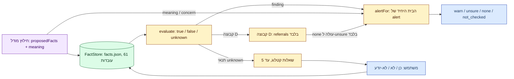

# 06 — מנוע הכללים

## עקרון־על

המנוע הדטרמיניסטי הוא היחיד שפוסק; מודל/נתב לעולם לא מכריעים הלכה, לעולם לא מחזירים ״מותר״, ולעולם לא מורידים חשש. כל נוסחי החבילה נאסרים מהמילים מותר/אסור כמילה נפרדת (בדיקת TOELET-02). מקור: [docs/18](../../18-toelet-rules.md), [docs/41](../../41-five-question-contract.md).

**תרשים — מעובדה להתראה:**



## קטלוג עובדות — בית יחיד

- נוסחים ומזהים: [`rules/chafetz-chaim/facts.json`](../../../rules/chafetz-chaim/facts.json) → `FACT_CATALOG` (61 עובדות). TOELET-04 נכשל אם הקטלוג סוטה מ־facts.json.
- המרה יחידה לחנות עובדות: [`engine/src/liveFacts.ts`](../../../engine/src/liveFacts.ts) `factStoreFromExtraction` (`proposedFacts + meaning + תשובות משתמש`).
- קבלה לפי ביטחון: [`extractor/factPolicy.ts`](../../../engine/src/extractor/factPolicy.ts) — דוחה ציונים לא־סופיים/מחוץ לטווח; **לעולם לא חותך** ציון ל־0..1 (חיתוך 2→1 קידם בעבר meaning פגום לעובדה ידועה). מקור: [AGENTS.md](../../../AGENTS.md).

## חבילות חפץ חיים — `live_draft`

החלטת בעלים 2026-10-27: `CC_ALL_DRAFT_PACK` (11 חבילות, 234 תזכורות) רץ בזרימה החיה כאילו אושר — `evaluate(..., ruleMode:'live_draft')` ⇒ findings עם `draft:true`; מתג `LHG_CC_RULES=live|off`. סקירת מומחה נדחית לסבב שיפור. מקור: [AGENTS.md](../../../AGENTS.md), [docs/18](../../18-toelet-rules.md).

חסמים קשיחים (לעולם לא נשברים):
- כלל רק מעלה ל־`warn` (רק בתוך `alertFor`) או שואל (עד 5) — לעולם לא מוריד ל־`none`.
- עובדה חסרה = **unknown**, לעולם לא false; ״לא יודע״ = `null` = unknown.
- תועלת מוצהרת לבדה מתירה **כלום** (LIVE-05).
- כשל מנוע ⇒ `rules.notChecked=true`, ההתראה ללא שינוי.
- חריגים באותה סמנטיקה תלת־ערכית: חריג unknown/במחלוקת חוסם finding ועשוי לדרוש בירור.

## לוגיקה תלת־ערכית

`evaluate` ב־[engine/src/evaluate.ts](../../../engine/src/evaluate.ts) על `FactStore` ב־[engine/src/factStore.ts](../../../engine/src/factStore.ts): כל תנאי/חריג ∈ {true, false, unknown}. תנאי unknown ⇒ שאלת בירור עליו (TOELET-06/08); תנאי שנכשל ⇒ draft שמסביר איזה תנאי חסר (TOELET-07/09). כללים ב־`approved_only` (ברירת המחדל) מפיקים רק `draftObservations` פנימיים, לעולם לא findings למשתמש (TOELET-05/07/09).

## שאלות — חוזה (docs/18 קנוני, docs/41)

- עד **5 שאלות קטלוג** לבדיקה (`MAX_QUESTIONS=5` ב־[proxy/src/rules.ts](../../../proxy/src/rules.ts)); `question?` נשאר מראה תאימות של `questions[0]` ללקוחות ישנים בלבד.
- נוסחים רק מ־`FACT_CATALOG`; פורמט כן/לא/לא־יודע (`true/false/null`). שאלה שנענתה (גם ״לא יודע״) לא נשאלת שוב.
- כשיש ≥1 שאלת קטלוג, שאלות ה־`analysis.questionsHe` החופשיות מושעות (מערך ריק); בלעדיהן נשמרת לכל היותר שאלת analysis אחת. מקור: [handler.ts](../../../proxy/src/handler.ts).
- מטמון השאלות ב־`docs/18`: שאלת משתמש ≠ עובדה מאושרת לשימוש חוזר ללא provenance/scope/validity. מקור: [AGENTS.md](../../../AGENTS.md).

## קבוצה D — הפניה בלבד

כל 73 סעיפי קבוצה D מפיקים `rules.referrals?: RabbiReferral[]` בלבד — גם בכיסוי חלקי וגם ב־approved fixtures. אין מהם finding, draft observation או פסק. הפניה ממתינה משאירה `needs_clarification`; ב־`alertFor` מעלה `none→unsure` בלבד. ההפניות אינן במכסת 5 השאלות. נתוני runtime נוצרים ב־`scripts/generate-referral-data.mts`; בדיקת workerd ב־`proxy/test/referralWorker.test.ts` חייבת להישאר ירוקה. מקור: [docs/42](../../42-rabbi-referral-artifact.md), [AGENTS.md](../../../AGENTS.md).

## `alertFor` — בית יחיד לרמת ההתראה

```text
if rules.findings.length > 0           → warn
else extractionAlert(outcome)          → warn/unsure/none/not_checked
   (דילוג gate ⇒ none; כשל ⇒ not_checked; concern/meaning ⇒ warn)
if alert == none ויש referral/question/needs פתוח → unsure
```

מקור: [`alertFor` ב־handler.ts:131](../../../proxy/src/handler.ts#L131). ה־`analysis` הוא הסבר בלבד (refs, לא שמות) ולעולם לא משנה את `alert`.

## כיסוי ומשמעת נתונים

- שקלול סופי לפי `disposition`: partial דורש קישורי runtime ראשוניים; blocked דורש `blocker` עם קטגוריה/סיבה/URL מקור. סכום 177 הסעיפים ושני ה־generators נבדקים (`--check`). מקור: [docs/25](../../25-final-disposition.md), [AGENTS.md](../../../AGENTS.md).
- רק 42/177 סעיפים ניתנים להכרעה מההודעה+שיחה אחרונה; 57 דורשים היסטוריה רחבה; 73 דורשים ראיות חיצוניות/פסיקה (נשארים unknown). מקור: [docs/32](../../32-context-requirements-map.md).
- מקור אמת יחיד לכל כלל; adapters/UI צורכים אותו בלבד. שימוש בדוגמאות סינתטיות בלבד.
