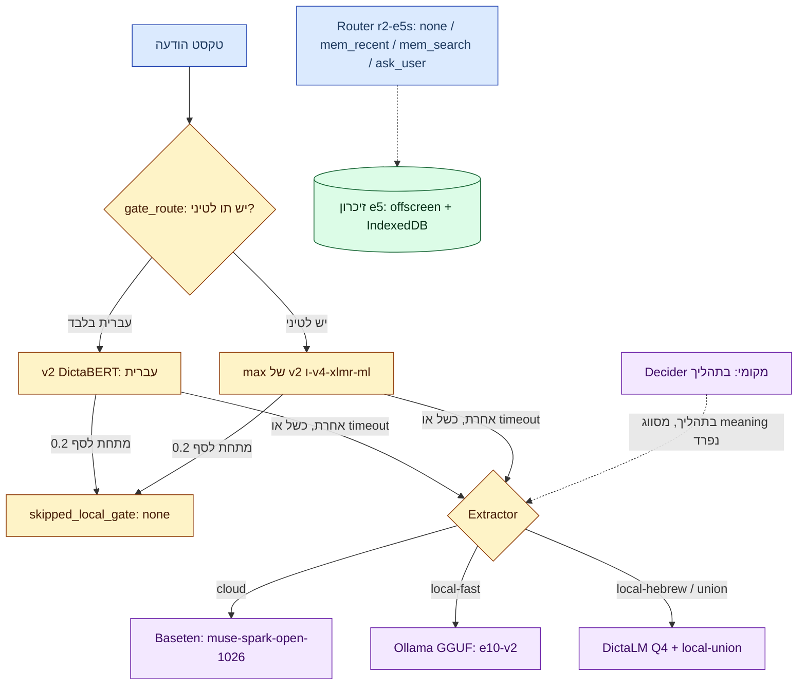

# 07 — מודלים ולמידת מכונה

**תרשים — מפת המודלים:**

## Gate classifier (מסווג מהיר)

תפקיד: לדלג על קריאת מודל יקרה כשההסתברות לחשש נמוכה. **Recall-first**: כשל/timeout תמיד מסלים למודל.

| פריט | ערך | מקור |
|---|---|---|
| חי (מאז 2026-10-28) | עברית בלבד → v2; אות לטינית → `max(v2, v4-xlmr-ml)` | [docs/31](../../31-multilingual-routed-gate.md), [`gate_route.py`](../../../classifier/gate_route.py) |
| סף | `LHG_GATE_THRESHOLD=0.2`; מתחת ⇒ `skipped_local_gate` ⇒ `none` | [handler.ts](../../../proxy/src/handler.ts) |
| פריסה | Oracle ראשי (timeout 800ms) → Modal fallback (1500ms) → מודל | [AGENTS.md](../../../AGENTS.md) |
| ניקוד | `max_length 96, strip` — משוכפל ב־`oracle/server.py` וב־`serve_modal.Gate._score`; לשנות יחד | [AGENTS.md](../../../AGENTS.md) |

ממצאים מדודים (docs/31, סט `eval_codex_v2` + holdout):
- ר(full routed max: סך החטאות **13** מול 22 (v2 לבד) ו־26 (xlmr לבד).
- כל מודל יחיד שאומן על תרגומים איבד recall של סרקזם עברי (6–10 החטאות מול 1) — גם ב־2× משקל עברי. לכן ניתוב, לא החלפה.
- Oracle: 758/758 התאמה ב־0.2, p50 עברית 126ms / לטינית 234ms. Modal: 758/758, max diff 5e-5.

משמעת הערכה: שיפוט רק על סט **עצמאי** (`classifier/gen_eval.py`, ספק/prompt אחר, מעולם לא אומן עליו). ציוני אותו־מחולל היו אופטימיים (v1: 0.986 פנימי מול 0.906 ב־Codex eval). סט שהנחה שינויי נתונים ⇒ מייצרים חדש. כלל הרצה: `py -m modal run classifier/eval_candidates.py --runs v2,<run>` (הראשון = baseline). Runbook: `.claude/skills/lhg-gate-evaluation/SKILL.md`.

## Cloud extractor

- חוזה: JSON עם `proposedFacts` (alias:[bool,quote] במצב מקומי) + `meaning` + `directAssessment` + `needs`. ה־`proposedFacts` **אינם** בתשובת `/check` — למדידה מריצים eval worker זמני (`wrangler dev --remote`, toml מחוץ למאגר). מקור: [AGENTS.md](../../../AGENTS.md), `classifier/eval_facts.py`.
- ברירת מחדל: Baseten `muse-spark-open-1026` (דרך Brain `agent_kind=baseten` בנתיב הפרטי, ישיר בנתיב הציבורי). ראו [04](04-check-modes-and-presets.md).
- כל הספקים חייבים לעבור smoke חי תחת timeout 20s של ה־Worker לפני כניסה לרשימה. מקור: [cloudModels.ts](../../../proxy/src/cloudModels.ts).

## Local extractor (Ollama GGUF)

| מנוע | מודל | חוזה | מקור |
|---|---|---|---|
| `extractor-7b-q4` | Qwen 7B Q4_K_M, **e10-v2** (מחליף e8) | contract v2, 18 facts | [docs/49](../../49-extractor-v2-ollama.md) |
| `dictalm-q4` | DictaLM 2.0 Q4_K_M | contract v1, 8 facts (לא אומן מחדש ל־v2) | [docs/49](../../49-extractor-v2-ollama.md) |

- GGUF ציבוריים ב־HF (`yonicc/lhg-extractor-*-gguf`). Q4_K_M שמר JSON תקין (0 שגיאות פורמט) לעומת Torch int8 ששיבש פלט. מקור: [docs/40](../../40-local-extractor-gguf-cpu.md).
- ציון = הסתברות הטוקן של המודל עצמו (`ollama-client.js scoreKeys`: min P של טוקן ראשון של מפתח, P של true/false, מ־`logprobs`; אומת חי על Ollama 0.40.12). חסר/לא־מיושר ⇒ אין ציון ⇒ `factPolicy` דוחה. זוג לא תקין אחד נזרק לבדו; רק פלט non-JSON/object נכשל כולו. `done_reason:'length'` נכשל. מקור: [AGENTS.md](../../../AGENTS.md), [docs/45](../../45-ollama-local.md).
- מ־18 מזהי החוזה, 6 הם `confirmedByUserOnly` בלבד — מדווחים כך, לעולם לא כ־unknown IDs. מקור: [docs/49](../../49-extractor-v2-ollama.md).

**שער parity ושחרור (docs/49):** e10-v2 Q4 **נכשל** בשער (Set A/8 recall 0.6288→0.5939; Set B/18 precision 0.9239→0.8997; גבול −0.02). הבעלים אישר במפורש שחרור (אפשרות A, 2026-10-29) כי precision של Set B/8 (0.9259 ב־recall 0.8427) טוב בהרבה מ־e8 (0.596 ב־recall דומה 0.854). השער נשמר להחלפות עתידיות; `hf_publish_modal.py` דורש `--allow-parity-regression` מפורש ומסרב לדוחות חלקיים.

**סט עצמאי (docs/47, `research/independent-eval-20261029/`):** מחולל מספק אחר + מתייג שני עיוור; תוויות מוקפאות ב־hash לפני פתיחת הקובץ החתום. אסור לאמן/לכייל/לתקן עליו. עליו: e8 הזיות (P 0.60) מול e10-v2 ‏P 0.94 על אותם 8 facts. מקור: [docs/47](../../47-independent-eval-20261029.md).

## Local memory embeddings (e5)

- `multilingual-e5-small` מקוונט (dim 384, ~5.5ms/doc ב־Node POC). חיפוש brute-force cosine מדויק עד ~20k וקטורים — אין צורך ב־ANN בקנה מידה אישי. embeddings/index ב־offscreen בלבד, לעולם לא ב־service worker. מקור: [docs/33](../../33-browser-vector-memory.md), [docs/36](../../36-extension-local-memory.md).
- מודל יורד מפורשות ב־options (~135MB); הסקה cached-only בלבד.

## Context router (r2-e5s)

- היקף בעלים: מחליט רק `none | mem_recent | mem_search | ask_user` (`classifier/router/labels.json` → heads, מיפוי יחיד ב־`evaluate.py heads_of`). שליפה היא קוד דטרמיניסטי, לעולם לא model tool loop. מקור: [docs/34](../../34-local-context-router.md), [docs/35](../../35-local-router-evaluation.md).
- שיגור: `emb8` בלבד (int8 רק לטבלת embeddings); `quantize_dynamic` מלא שיבש החלטות (173/459 flips). כיול ספים על ה־artifact המשוגר. DictaBERT לא נטען ב־transformers.js 2.17 (`NFD`). מקור: [AGENTS.md](../../../AGENTS.md).
- אינטגרציה: [`extension/memory-router*.mjs`](../../../extension/memory-router.mjs) + `builder.mergeMemory`; `lhgRouterEnabled` כבוי בברירת מחדל, דורש ייבוא תיקיית r2-e5s מוצמדת (~191MiB), cached-only. על הסט העצמאי r3 **לא** ניצח את r2. מקור: [docs/44](../../44-router-memory-integration.md), [docs/47](../../47-independent-eval-20261029.md).

> **דרך Brain — פתוח:** ענף ה־`codex` ב־`/api/v1/chat/completions` משמיט `system_prompt` (תיקון בתהליך, 2026-10-26); עד אימות — הוראות בתוך תור המשתמש ל־`agent_kind=codex`. מקור: [AGENTS.md](../../../AGENTS.md). לא אומת סטטוס נוכחי.
