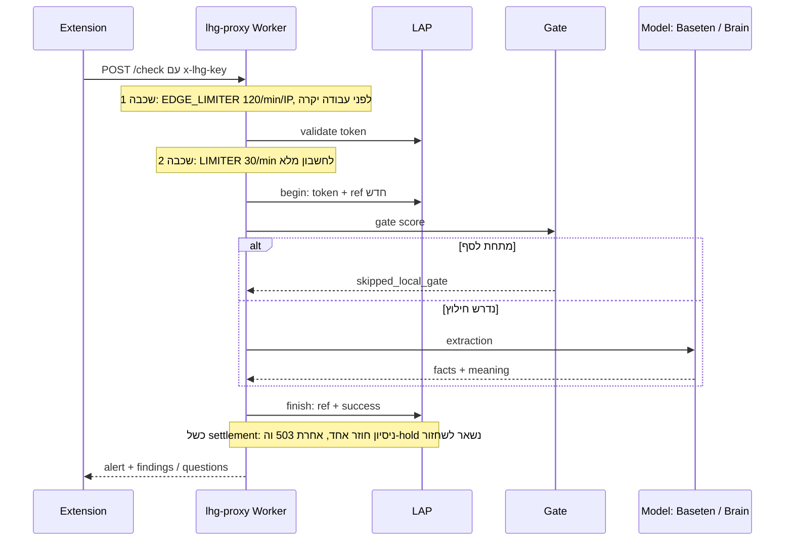

# 08 — אבטחה, חיוב ותפעול

## אימות והרשאה

| מנגנון | פרטים | מקור |
|---|---|---|
| `lap_...` token (ציבורי) | מנוהל ב־`https://lhg.ysho.uk` (legacy `lap.ysho.uk` מפנה); ביטול/grants/יתרה/quota יומית נאכפים מרכזית ב־LAP | [accountAccess.ts](../../../proxy/src/accountAccess.ts), [AGENTS.md](../../../AGENTS.md) |
| Legacy access key (פרטי) | תקף להתקנת הבעלים הקיימת; picker מודלים מלא | [docs/50](../../50-public-distribution.md) |
| `LHG_PUBLIC_CHECK` | נגזר **שרתית בלבד** אחרי אימות `lap_` — גוף/כותרות בקשה לא יכולים לבחור privilege. אין Baseten key ⇒ fail-closed, לעולם לא fallback ל־Brain | [handler.ts](../../../proxy/src/handler.ts#L208), [docs/50](../../50-public-distribution.md) |
| השוואת מפתחות | `sameKey` קבוע־זמן (XOR מצטבר) למפתח הגישה | [handler.ts](../../../proxy/src/handler.ts#L163) |

התוסף שולח `x-lhg-key`; `401 ⇒ not_configured`, `429 ⇒ not_checked (rate_limited)`. מקור: [background.js](../../../extension/background.js).

## Rate limits (שני שלבים, לפני עבודה יקרה)

```text
POST /check|/warm → EDGE_LIMITER 120/min/IP (cf-connecting-ip בלבד)
  → LAP validate → LIMITER 30/min/חשבון מלא (כל הטוקנים/מכשירים חולקים)
  → begin/reservation → gate → extraction
```

- `EDGE_LIMITER` נצרך **לפני** קריאות מרכזיות; `LIMITER` אחרי validate ולפני reservation/gate. Legacy keys צורכים גם הם `LIMITER`. מקור: [AGENTS.md](../../../AGENTS.md).
- מגבלות Cloudflare הן בקרות קבלה מקורבות לכל location, **לא** תקרה פיננסית גלובלית — ה־quota היומית המרכזית היא הסמכותית.
- שגיאת limiter ⇒ `503 limiter_unavailable`; סירוב ⇒ `429 rate_limited` עם `retry-after: 60`. מקור: [throttle.ts](../../../proxy/src/throttle.ts).
- Cookie Max-Age לבדו אינו תפוגת session שרתית. סקירה: [docs/27-security-review.md](../../27-security-review.md).

**תרשים — reservation, settlement ושכבות ההגבלה:**



## חיוב — reservation / settlement

זרימה ב־[accountAccess.ts](../../../proxy/src/accountAccess.ts): `validate` → (ל־`/check`) `begin {token, ref=randomUUID}` → בדיקה → `finish {ref, success}`. `success` ⇔ `status ∈ {extracted, skipped_local_gate}`. ‏`finish` idempotent לכל ref; כשל settlement (5xx) מנוסה שוב פעם אחת, ואז `503 settlement_unavailable` וה־hold נשאר לשחזור אדמין. **כל סבב needs/בירור = בקשה חדשה ומחויבת בנפרד.** מקור: [docs/48](../../48-cloud-context-loop.md).

גבולות בקשה: טקסט ≤2000 תווים (`413 text_too_long`), `userNote` ≤500 (נחתך, לא נדחה), `confirmedFacts` ids מהקטלוג ≤20. מקור: [limits.ts](../../../proxy/src/limits.ts), [handler.ts](../../../proxy/src/handler.ts).

## סודות (שמות בלבד — ללא ערכים)

Worker secrets: `LHG_ACCOUNT_KEY`, `LHG_BASETEN_KEY`, `LHG_BRAIN_TOKEN`, `LHG_ACCESS_KEY`, `LHG_GATE_KEY`, `LHG_GATE_ORACLE_KEY`. Modal secret `lhg-gate` (`GATE_KEY`) זהה ל־`LHG_GATE_KEY`; Oracle `GATE_KEY` ב־`/home/ubuntu/lhg-gate/gate.env` זהה ל־`LHG_GATE_ORACLE_KEY`. העלאה רק ב־`wrangler secret bulk <json מחוץ למאגר>` — `secret put` ב־PowerShell 5.1 שומר ערך שגוי בשקט. מקור: [AGENTS.md](../../../AGENTS.md).

כל קריאות ה־server ב־Worker: `redirect:'manual'` + דחיית 3xx מפורשת (Workers לא מממש `redirect:'error'` — זורק לפני בקשה). לעולם לא עוקבים אחרי redirect עם credentials של שותף. מקור: [accountAccess.ts](../../../proxy/src/accountAccess.ts#L10), [baseten.ts](../../../proxy/src/baseten.ts).

## פריסה ושחרור (3 מקומות — חוק בעלים 2026-10-27)

כל שחרור תוסף מחייב את שלושתם; חלק מ״done״, לא אופציונלי. Bump `version` ב־manifest, commit, push, ואז:

1. **BI-1**: `scripts\release-extension.ps1` — מסרב אלא אם `HEAD == origin/main` וה־`extension/` נקי; מריץ בדיקות; מפרסם את ה־commit המדויק ל־LAP (TZ `package-extension.py <sha>`) ומאמת חי ש־`/downloads/version.json` ו־SHA-256 של ה־ZIP תואמים.
2. **YONI-PC**: `bash scripts/install-from-lap.sh` — מתקין את ה־ZIP המאומת ל־`/home/yoni/lashon-hara-guard-gmail/extension` (גיבוי נשמר). ל־BI-1 אין נתיב SSH ל־YONI-PC — הצעד רץ שם.
3. המשתמש טוען מחדש את התוסף ומרענן את הלשונית.

פריסת Worker: `npx wrangler deploy` מ־BI-1 (מחובר כ־yonicc). פריסת Gate: Oracle `bash deploy.sh <tag> v4-xlmr-ml` (ללא ארגומנט שני = rollback עברי בלבד); בדיקת image חדש על פורט צד 8091 לפני החלפה. מקור: [AGENTS.md](../../../AGENTS.md), [docs/31](../../31-multilingual-routed-gate.md).

## חוב תפעולי ידוע

- **Retry כפול־חיוב** (נדחה במפורש ב־docs/50): כל `/check` יוצר ref חדש; retry תחבורתי אחרי תשובה אבודה מחייב פעמיים. תיקון עתידי: operation ID יציב ללקוח. ראו [09](09-decisions-and-debt.md).
- אין `min_containers` ב־Modal ללא החלטת משתמש (always-on ≈ $2.6/יום).
- קבצי BI-1 המועתקים ל־Oracle הם CRLF ⇒ המרה ל־LF על המארח תחילה.
