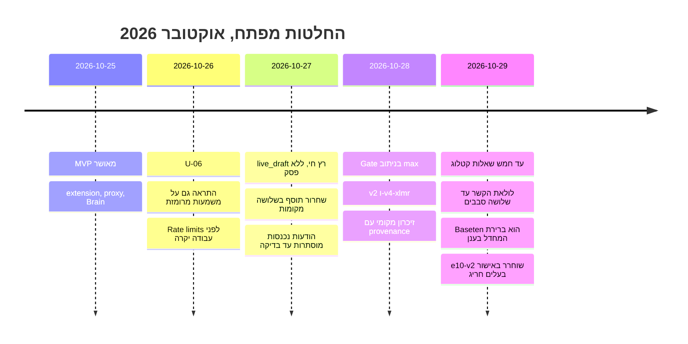

# 09 — החלטות, שאלות פתוחות וחוב טכני

## החלטות מפתח (ADR מקוצר)

| תאריך | החלטה | מקור |
|---|---|---|
| 2026-10-25 | בניית MVP מאושרת: extension → proxy → Brain | [docs/06-decisions.md](../../06-decisions.md), [AGENTS.md](../../../AGENTS.md) |
| 2026-10-26 | U-06: להתריע גם על משמעות שעלולה להתפרש כגנאי, ללא מילת גנאי מפורשת | [docs/06-decisions.md](../../06-decisions.md) |
| 2026-10-26 | MVP runtime: EDGE 120/min + LIMITER 30/min לפני עבודה יקרה | [AGENTS.md](../../../AGENTS.md) |
| 2026-10-27 | נכנסות: מוסתרת עד בדיקה; כשל/אזהרה ⇒ מוסתרת עד «הצג» מפורש | [docs/15](../../15-incoming-hold.md) |
| 2026-10-27 | `live_draft`: חבילת הטיוטה רצה חי; אין פסק, אין «מותר», רק warn/שאלות | [docs/18](../../18-toelet-rules.md) |
| 2026-10-27 | שחרור תוסף = 3 מקומות (BI-1, lhg.ysho.uk, YONI-PC) | [AGENTS.md](../../../AGENTS.md) |
| 2026-10-28 | Gate חי: routed max (v2 / max(v2, xlmr)) — לא החלפת מודל | [docs/31](../../31-multilingual-routed-gate.md) |
| 2026-10-28 | זיכרון מקומי: כל טקסט משדות מאובחנים (כולל טיוטות שלא נשלחו), provenance נשמר | [docs/35](../../35-local-memory-ingestion-and-browser-test.md) |
| 2026-10-29 | מכסת שאלות 1 → עד 5; חוזה נשבר ללא תאימות לאחור | [docs/41](../../41-five-question-contract.md), [docs/18](../../18-toelet-rules.md) |
| 2026-10-29 | לולאת הקשר משותפת ענן/מקומי, עד 3 סבבים, כל סבב מחויב | [docs/48](../../48-cloud-context-loop.md) |
| 2026-10-29 | ברירת מחדל ענן: Baseten `muse-spark-open-1026` (שני ה־builds) | [cloudModels.ts](../../../proxy/src/cloudModels.ts) |
| 2026-10-29 | ציבורי: רק Baseten ישיר; `LHG_PUBLIC_CHECK` שרתית בלבד | [docs/50](../../50-public-distribution.md) |
| 2026-10-29 | יוצאות לעולם לא לוכדות send; bypass מפורש בשליחה שנייה | [AGENTS.md](../../../AGENTS.md), [compose-watch.js](../../../extension/compose-watch.js) |
| 2026-10-29 | שחרור e10-v2 Q4 למרות כשל parity (אפשרות A של הבעלים) | [docs/49](../../49-extractor-v2-ollama.md) |
| 2026-10-29 | מרשם חוב טכני `docs/TECH-DEBT.md`; אימון meaning ל־extractor נפרד מה־decider | [docs/TECH-DEBT.md](../../TECH-DEBT.md) |

החלטות U-01..U-07 המלאות: [docs/06-decisions.md](../../06-decisions.md).

**תרשים — ציר זמן החלטות:**

## שאלות פתוחות (מ־docs/06 — טרם הוכרעו)

1. עצירה קשיחה מול בירור ניתן לדילוג במצב לא־מוכרע (שאלה 1).
2. מוסמך אישור כללים הלכתיים/משפטיים ותחום שיפוט (שאלה 3) — סקירת מומחה ל־drafts עדיין ממתינה.
3. שמירת יחסים רגישה: היתר, משך, סנכרון (שאלה 4).
4. פרופיל הלכתי במחלוקת והצגתו (שאלה 6).
5. תקציב הפרעות ותקרת שאלות ארוכת־טווח (R-02); יעד התראות־שווא (I-04, הצעה: <5%).
6. בקרה כפולה AI־ישירה מול מנוע (R-01) — לא אומת אם מומשה.

## חוב טכני ידוע

| חוב | חומרה | מקור |
|---|---|---|
| Retry transport עלול לחייב פעמיים (ref חדש לכל `/check`); נדחה במפורש ע״י הבעלים | כספי | [docs/50](../../50-public-distribution.md) |
| `local-union` אינו שיפור איכות מדוד עצמאית מעל Qwen v2 | איכות | [docs/49](../../49-extractor-v2-ollama.md) |
| Extractor מקומי לא אומן עם context — קטעי סבב־המשך הם untrusted ללא תביעת parity | איכות | [docs/48](../../48-cloud-context-loop.md) |
| DictaLM נשאר על contract v1 (8 facts) — ללא אימון v2 | כיסוי | [docs/49](../../49-extractor-v2-ollama.md) |
| ששת ה־facts שהם `confirmedByUserOnly` — לעולם לא מהמודל | כיסוי | [docs/49](../../49-extractor-v2-ollama.md) |
| אין תפוגה מתוזמנת לרשומות שיחה/משתתפים/עובדות/יחסים ב־`lhg-context` | פרטיות | [PRIVACY.md](../../../PRIVACY.md#L16) |
| Retention של ספקים (Baseten/Brain/Oracle) לא אומת | פרטיות | [PRIVACY.md](../../../PRIVACY.md#L39) |
| שדה `meaning` בחוזה ה־extractor המקומי (concern/mechanism/ציטוט) — עבודה עתידית מאושרת, טרם מומש | איכות | [docs/TECH-DEBT.md](../../TECH-DEBT.md) |
| Union של DictaLM הישן עם e10-v2 טרם נמדד מחדש — אין לפרסם מדידת union ישנה על הזוג החדש | איכות | [docs/TECH-DEBT.md](../../TECH-DEBT.md) |
| Decider מקומי (מסווג meaning נפרד) — **בתהליך**; אינו משלים את חוזה ה־extractor | תיעוד | [docs/TECH-DEBT.md](../../TECH-DEBT.md) |

## אי־התאמות שמצאתי בין מסמכים לקוד (לסקירת המפקח)

1. **שם המסלול ב־cloudModels מול handler:** `pickCloudModel` מחזיר default לכל absent/unknown, אך `handler.providerFromEnv` עם `choice=null` מחזיר את ספקית ה־env — יש לוודא שה־caller תמיד מעביר את תוצאת `pickCloudModel` (אומת חלקית; לא אומת נתיב absent מלא בקוד ה־handler שנסקר).
2. **מספר חבילות:** docs/18 כותב ״אחת עשרה חבילות ו־234 תזכורות״ בעוד AGENTS.md אומר ״eight source-linked reminder packs״ ל־`CC_ALL_DRAFT_PACK` — יש לאחד ספירה (packs מול sub-packs).
3. **גרסת תוסף במסמכים ישנים:** מסמכי 0.10/0.11 מתייחסים להתנהגויות (למשל panel shortcut `Ctrl+Shift++`) שהוחלפו ב־`Ctrl+Shift+L` native — המסמכים ההיסטוריים אינם מסומנים כולם כ־superseded.
4. **README שורשי מיושן:** עדיין מתאר ״טרם נבנו תוסף/מנוע״ ומפרט רק docs/01–08, בעוד המערכת חיה ב־0.14.0.
